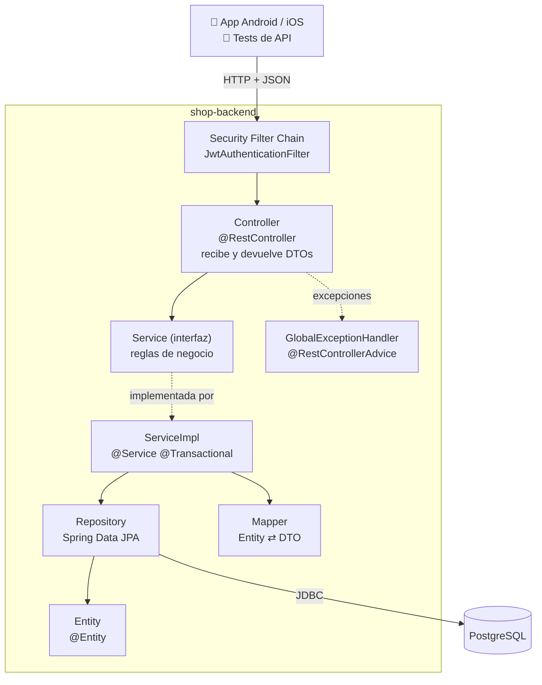
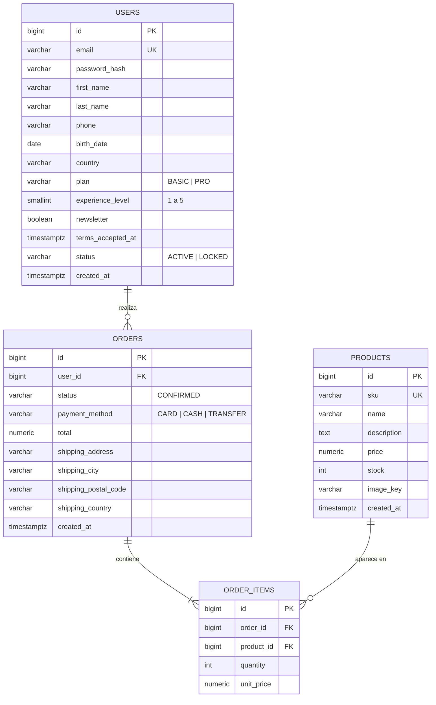
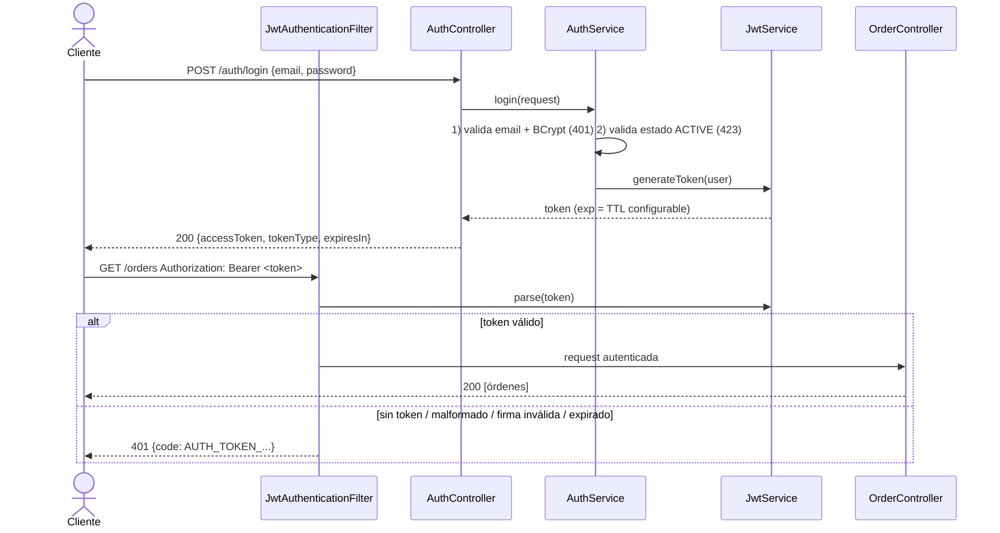
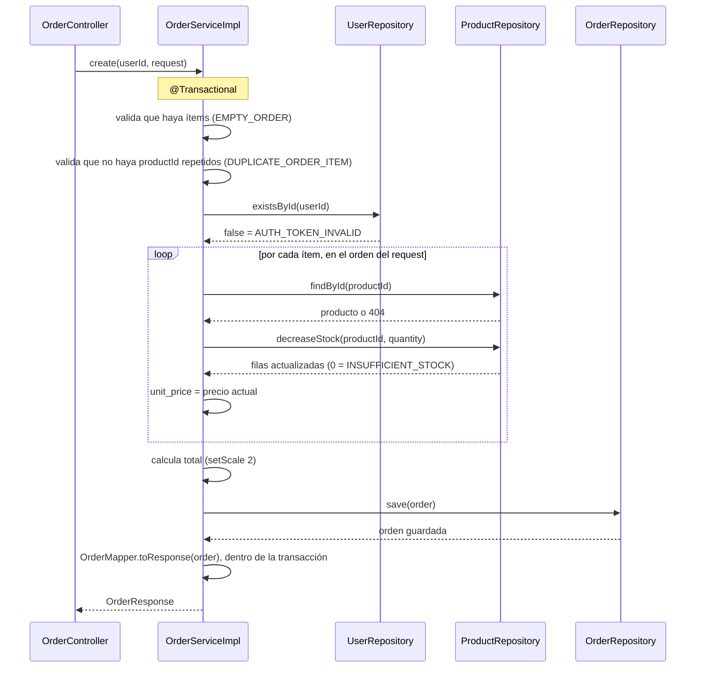

# shop-backend · Documento de Arquitectura

> Backend de práctica para el MVP de automatización móvil (Jetpack Compose + SwiftUI).
> Objetivo: una API REST sencilla, bien separada en capas y fácil de entender para un perfil junior,
> que además sirva para practicar pruebas de API (escenarios felices, negativos y de seguridad con JWT).

---

## 1. Alcance

| Incluido | Fuera de alcance (fase 2) |
|---|---|
| Login con JWT | Refresh token |
| Registro de usuarios | Recuperación de contraseña |
| Catálogo de productos (público) | Carrito en servidor (el carrito vive en la app) |
| Creación y consulta de órdenes (protegido) | Pasarela de pagos real |
| Perfil del usuario autenticado | Roles de administrador |
| Perfil `testing` con utilidades para pruebas | Imágenes servidas por el backend |

---

## 2. Stack tecnológico

| Área | Tecnología |
|---|---|
| Lenguaje | Java 21 |
| Framework | Spring Boot 3.x (Web, Data JPA, Security, Validation) |
| Seguridad | Spring Security + JWT (librería `jjwt`) + BCrypt |
| Base de datos | PostgreSQL 16 |
| Migraciones | Flyway |
| Documentación API | springdoc-openapi (Swagger UI en `/swagger-ui.html`) |
| Build | Gradle 8.x con Kotlin DSL (`build.gradle.kts`) y Gradle Wrapper (`./gradlew`) |
| Contenedores | Docker (Dockerfile multi-stage) + Docker Compose |
| Pruebas | JUnit 5, Mockito, MockMvc, Testcontainers |
| Observabilidad | Spring Boot Actuator (solo `/actuator/health`) |

Las versiones exactas de Spring Boot 3.x y jjwt 0.12.x se fijan en el `build.gradle.kts` del change de bootstrap.
Se usa siempre el **wrapper** (`./gradlew`), que descarga la versión de Gradle fijada en `gradle/wrapper/gradle-wrapper.properties`; no hace falta instalar Gradle.

### 2.1 Convenciones del proyecto

| Tema | Decisión |
|---|---|
| Idioma del código | Inglés: clases, métodos, variables, endpoints, valores de `ErrorCode` y JSON |
| Mensajes de la API | Inglés (`message` y `fieldErrors[].message`) |
| Comentarios y documentación | Español |
| Moneda | **USD** para todos los montos. En Java `BigDecimal`, en BD `numeric(12,2)`, en JSON un número con 2 decimales |
| Fechas | `Instant` en Java, `timestamptz` en BD, ISO-8601 en UTC en JSON (`2026-10-11T15:04:05Z`). `birthDate` es `LocalDate` (`yyyy-MM-dd`) |
| DTOs | `record` de Java. Sin Lombok |
| Mappers | Escritos a mano (sin MapStruct) |
| Inyección | Por constructor |
| Esquema de BD | Lo controla solo Flyway (`spring.jpa.hibernate.ddl-auto=validate`) |
| Reloj | Un único bean `Clock` en UTC; nadie llama a `LocalDate.now()` ni a `Instant.now()` sin pasarle el `clock` (ver §6.5) |
| JSON de entrada | Estricto: no convierte `"2"` → `2` ni `1.5` → `1` (ver §9.3). Los campos desconocidos se ignoran |

---

## 3. Arquitectura en capas

### 3.1 Vista general



### 3.2 Responsabilidad de cada capa

| Capa | Hace | NO hace |
|---|---|---|
| **Controller** | Recibe la petición, valida el DTO con `@Valid`, llama al service, devuelve el código HTTP | Lógica de negocio, acceder al repository, devolver entidades |
| **Service** (interfaz) | Define el contrato de negocio (qué se puede hacer) | Detalles de implementación |
| **ServiceImpl** | Reglas de negocio, transacciones, construir entidades nuevas, lanzar `BusinessException` | Conocer HTTP (`ResponseEntity`, códigos de estado) o seguridad (`AuthUser`); devolver `Optional` o `null` |
| **Mapper** | Convertir Entity → DTO de respuesta (una sola dirección) | Lógica de negocio, construir entidades |
| **Repository** | Leer y guardar en la base de datos | Reglas de negocio |
| **Entity** | Representar una tabla | Exponerse directamente en la API |
| **GlobalExceptionHandler** | Traducir excepciones a respuestas JSON uniformes | Decidir reglas de negocio |

Qué cruza cada frontera:

| Frontera | Viaja | Nunca viaja |
|---|---|---|
| Controller → Service | DTO del request e ids (`Long userId`, no `AuthUser`) | `HttpServletRequest`, `ResponseEntity`, entidades |
| Service → Controller | DTO de respuesta, `List<DTO>` o `BusinessException` | Entidades, `Optional`, `null` |
| Service → Repository | Entidades e ids | DTOs |

El mapper solo convierte de Entity a DTO porque la entidad nueva necesita datos que no vienen en el request (`passwordHash`, `createdAt`, `status`), y esos los decide el service. Estas reglas las verifica `ArchitectureTest` (ArchUnit).

### 3.3 Regla de dependencias

Las dependencias van **siempre hacia abajo**:

```
Controller  →  Service (interfaz)  →  Repository  →  Entity
                    ↑
              ServiceImpl
```

- Un controller **nunca** usa un repository directamente.
- Un repository **nunca** conoce a un service.
- Los DTOs entran y salen por el controller; las entidades no salen del service.
- Si una feature necesita datos de otra, su `ServiceImpl` usa directamente el repository de esa feature.
  Ejemplo: `AuthServiceImpl` usa `UserRepository`, que sí ve el `passwordHash`, en lugar de `UserService`.
  Así `UserService` no tiene que exponer el hash.
  Es una **concesión consciente** para mantenerlo simple: acopla un poco las features, pero solo en lectura
  y solo en estos casos: `AuthServiceImpl` → `UserRepository`, `OrderServiceImpl` → `ProductRepository`
  y `UserRepository` (para verificar que el usuario del token existe), `TestSupportController` → `UserRepository`.

### 3.4 Validación vs. regla de negocio

| Tipo | Dónde | Respuesta | Ejemplos |
|---|---|---|---|
| **Validación** (formato del dato) | Anotaciones en el DTO + `@Valid` en el controller | 400 `VALIDATION_ERROR` con `fieldErrors` | Email inválido, campo vacío, contraseña débil, `quantity <= 0` |
| **Regla de negocio** (depende del dominio o de la BD) | `ServiceImpl` lanza `BusinessException(ErrorCode.X)` | El status y el `code` que defina `ErrorCode` | Menor de edad, términos no aceptados, orden vacía, stock insuficiente |

---

## 4. Estructura de paquetes (por feature)

Cada feature agrupa sus propias capas. Así un junior encuentra todo lo de "órdenes" en una sola carpeta.

```
src/main/java/com/shoplab/api
├── ShopApplication.java
├── auth/
│   ├── AuthController.java
│   ├── AuthService.java              ← interfaz
│   ├── AuthServiceImpl.java
│   └── dto/  LoginRequest.java, LoginResponse.java
├── user/
│   ├── UserController.java
│   ├── UserService.java / UserServiceImpl.java
│   ├── UserRepository.java
│   ├── UserMapper.java
│   ├── User.java                     ← entidad
│   ├── UserStatus.java, Plan.java    ← enums
│   └── dto/  RegisterUserRequest.java, UserResponse.java
├── product/
│   ├── ProductController.java
│   ├── ProductService.java / ProductServiceImpl.java
│   ├── ProductRepository.java
│   ├── ProductMapper.java
│   ├── Product.java
│   └── dto/  ProductResponse.java
├── order/
│   ├── OrderController.java
│   ├── OrderService.java / OrderServiceImpl.java
│   ├── OrderRepository.java
│   ├── OrderMapper.java
│   ├── Order.java, OrderItem.java, OrderStatus.java, PaymentMethod.java
│   └── dto/  CreateOrderRequest.java, OrderItemRequest.java, OrderResponse.java
├── security/
│   ├── SecurityConfig.java
│   ├── AuthUser.java                 ← record (id, email) del usuario autenticado
│   ├── JwtProperties.java            ← jwt.secret / jwt.ttl, valida el secreto al arrancar
│   ├── JwtService.java               ← interfaz
│   ├── JjwtService.java              ← implementación con jjwt
│   ├── InvalidTokenException.java    ← lleva el ErrorCode AUTH_TOKEN_*; oculta las excepciones de jjwt
│   ├── JwtAuthenticationFilter.java
│   ├── JwtAuthenticationEntryPoint.java   ← respuestas 401 en JSON
│   └── JsonAccessDeniedHandler.java       ← respuestas 403 en JSON (por si acaso)
├── config/
│   ├── OpenApiConfig.java            ← esquema bearerAuth para Swagger
│   └── ClockConfig.java              ← bean Clock en UTC (§6.5)
├── common/
│   ├── exception/  GlobalExceptionHandler.java, BusinessException.java, ErrorCode.java
│   ├── validation/ ValidationPatterns.java   ← regex compartidas (países, contraseña, código postal)
│   └── dto/        ErrorResponse.java, FieldErrorResponse.java
└── testsupport/                      ← solo activo con el perfil "testing"
    ├── TestSupportController.java
    ├── TestDataResetService.java
    ├── ExpiredTokenFactory.java
    └── ChaosFilter.java

src/main/resources
├── application.yml
├── application-dev.yml
├── application-testing.yml
└── db/migration/   V1__..., V2__..., (Flyway)
```

---

## 5. SOLID aplicado (con ejemplos del proyecto)

| Principio | Cómo se aplica aquí |
|---|---|
| **S** – Responsabilidad única | `OrderController` solo maneja HTTP; `OrderServiceImpl` solo reglas; `OrderMapper` solo conversiones. |
| **O** – Abierto/cerrado | Cada valor de `ErrorCode` lleva su `HttpStatus` y su mensaje por defecto. Un error de negocio nuevo es un valor más en el enum y el `GlobalExceptionHandler` no cambia. Por eso existe una sola `BusinessException` (no hay `NotFoundException`). |
| **L** – Sustitución de Liskov | Cualquier implementación de `JwtService` (real o fake en tests) funciona igual para el filtro, porque todas fallan con `InvalidTokenException` y nunca con excepciones de jjwt. |
| **I** – Segregación de interfaces | Interfaces pequeñas por feature (`AuthService`, `OrderService`) en lugar de un `ShopService` gigante. |
| **D** – Inversión de dependencias | Los controllers dependen de interfaces (`OrderService`), no de `OrderServiceImpl`. Inyección por constructor. |

Ejemplo mínimo:

```java
public interface OrderService {
    OrderResponse create(Long userId, CreateOrderRequest request);
    List<OrderResponse> findAllByUser(Long userId);
    OrderResponse findByIdForUser(Long orderId, Long userId);
}

@RestController
@RequestMapping("/api/v1/orders")
public class OrderController {

    private final OrderService orderService;   // depende de la interfaz (D)

    public OrderController(OrderService orderService) {
        this.orderService = orderService;
    }

    @PostMapping
    public ResponseEntity<OrderResponse> create(@AuthenticationPrincipal AuthUser user,
                                                @Valid @RequestBody CreateOrderRequest request) {
        OrderResponse created = orderService.create(user.id(), request);
        return ResponseEntity.status(HttpStatus.CREATED).body(created);
    }
}
```

---

## 6. Modelo Entidad-Relación

### 6.1 Diagrama



### 6.2 Relaciones

| Relación | Cardinalidad | Explicación |
|---|---|---|
| USERS → ORDERS | 1 a 0..N | Un usuario puede tener cero o muchas órdenes. |
| ORDERS → ORDER_ITEMS | 1 a 1..N | Una orden siempre tiene al menos un ítem. |
| PRODUCTS → ORDER_ITEMS | 1 a 0..N | Un producto puede aparecer en muchas órdenes. |

### 6.3 Decisiones de diseño

- **`unit_price` en `ORDER_ITEMS`** guarda el precio *al momento de la compra*. Si el precio del producto cambia después, la orden histórica no se altera.
- **La dirección de envío se copia en `ORDERS`** (snapshot) en lugar de una tabla `ADDRESSES`: más simple para el MVP.
- **`total` se calcula en el backend**, nunca se acepta el que envía la app.
- **No hay tabla de carrito**: el carrito vive en la app y se envía completo en `POST /orders`.
- **Restricciones en BD**: `email` y `sku` únicos; `quantity > 0`; `stock >= 0`; `price >= 0`.
- **Montos en USD**: `price`, `total` y `unit_price` son `numeric(12,2)`. No hay columna de moneda porque solo existe USD.
- **Fechas con zona horaria**: todas las columnas de fecha y hora son `timestamptz` y se guardan en UTC.
- **Email en minúsculas**: se normaliza (`trim` + `toLowerCase`) al registrar y al hacer login, así `Standard@ShopLab.dev` y `standard@shoplab.dev` son el mismo usuario.
  La normalización se hace en el *compact constructor* del `record` (`RegisterUserRequest` y `LoginRequest`), así ocurre **antes** de `@Valid` y `" a@b.com "` es válido:

  ```java
  public record LoginRequest(String email, String password) {
      public LoginRequest {
          // se ejecuta al deserializar el JSON, antes de @Valid
          email = (email == null) ? null : email.trim().toLowerCase(Locale.ROOT);
      }
  }
  ```
- **`terms_accepted_at`**: la app envía `termsAccepted: true/false` y el backend guarda `now()` cuando es `true`.
- Los campos de `USERS` corresponden a los elementos visuales del formulario de registro:

| Campo | Elemento en la app |
|---|---|
| `first_name`, `last_name`, `email` | Text fields |
| `password` | Password field |
| `phone` | Text field numérico |
| `birth_date` | DatePicker |
| `country` | Dropdown |
| `plan` | Radio buttons |
| `experience_level` | Slider |
| `newsletter` | Switch |
| `terms_accepted_at` | Checkbox (obligatorio) |

### 6.4 Reglas de validación del registro (`POST /users`)

| Campo (JSON) | Regla | Si falla |
|---|---|---|
| `firstName`, `lastName` | Obligatorio, de 2 a 50 caracteres | 400 |
| `email` | Obligatorio, formato email, máximo 100 caracteres | 400 |
| `password` | Obligatorio, **de 8 a 20 caracteres**, solo caracteres ASCII visibles (sin espacios ni tildes), con al menos una mayúscula, una minúscula, un número y un carácter especial (`Secret_123` cumple) | 400 |
| `phone` | Opcional, solo dígitos, de 7 a 15 | 400 |
| `birthDate` | Obligatorio, formato `yyyy-MM-dd`, fecha en el pasado | 400 |
| `birthDate` | Edad >= 18 años (calculada en UTC, ver §6.5) | **422** `UNDERAGE_USER` |
| `country` | Obligatorio, código ISO 3166 alfa-2 de la lista soportada (`US`, `CO`, `MX`, `ES`, `AR`, `CL`, `PE`) | 400 |
| `plan` | Obligatorio: `BASIC` o `PRO` | 400 |
| `experienceLevel` | Obligatorio, entero de 1 a 5 | 400 |
| `newsletter` | Opcional, `false` por defecto | — |
| `termsAccepted` | Obligatorio (no nulo) | 400 |
| `termsAccepted` | Debe ser `true` | **422** `TERMS_NOT_ACCEPTED` |
| `email` | No debe existir en la BD | **409** `EMAIL_ALREADY_EXISTS` |

Primero se ejecuta `@Valid` (400). Solo si pasa, el service revisa las reglas de negocio en este orden: edad, términos y email duplicado.

**¿Por qué máximo 20 caracteres y solo ASCII?** BCrypt solo usa los primeros 72 bytes, y Spring Security 6.3+ lanza una excepción (que terminaría en un 500) con contraseñas más largas. Con 20 caracteres ASCII el máximo son 20 bytes, así que nunca se llega al límite. La regex vive en `ValidationPatterns.PASSWORD`:

```java
public final class ValidationPatterns {
    // al menos una minúscula, una mayúscula, un dígito y un especial; solo ASCII visible (0x21-0x7E)
    public static final String PASSWORD = "^(?=.*[a-z])(?=.*[A-Z])(?=.*\\d)(?=.*[^A-Za-z0-9])[\\x21-\\x7E]+$";
    public static final String COUNTRY = "US|CO|MX|ES|AR|CL|PE";
    public static final String POSTAL_CODE = "^[A-Za-z0-9 -]{3,10}$";

    private ValidationPatterns() {
    }
}
```

**Email duplicado con dos registros simultáneos.** El chequeo `existsByEmail` del service no basta si llegan dos peticiones al mismo tiempo: ambas lo pasan y la segunda choca con el `UNIQUE` de la BD. El service guarda con `saveAndFlush` (para que el `INSERT` se ejecute dentro del `try`) y traduce ese caso al mismo 409:

```java
if (userRepository.existsByEmail(request.email())) {
    throw new BusinessException(ErrorCode.EMAIL_ALREADY_EXISTS);
}
try {
    User saved = userRepository.saveAndFlush(user);
    return userMapper.toResponse(saved);
} catch (DataIntegrityViolationException e) {
    // otro registro con el mismo email ganó la carrera entre el exists y el insert
    throw new BusinessException(ErrorCode.EMAIL_ALREADY_EXISTS);
}
```

La única restricción `UNIQUE` de `users` es `email`, así que en este `catch` no hay otra causa posible.

### 6.5 Fechas y reloj (`Clock`)

Para que las reglas que dependen de "hoy" se puedan probar (por ejemplo, el usuario que cumple 18 años justo hoy), el reloj se inyecta:

```java
@Configuration
public class ClockConfig {
    @Bean
    public Clock clock() {
        return Clock.systemUTC();
    }
}
```

```java
// UserServiceImpl
LocalDate today = LocalDate.now(clock);
if (Period.between(request.birthDate(), today).getYears() < 18) {
    throw new BusinessException(ErrorCode.UNDERAGE_USER);
}
user.setTermsAcceptedAt(Instant.now(clock));
user.setCreatedAt(Instant.now(clock));
```

En los tests unitarios se usa un reloj fijo: `Clock.fixed(Instant.parse("2026-10-11T12:00:00Z"), ZoneOffset.UTC)`.

| Caso (con "hoy" = `2026-10-11` UTC) | `birthDate` | Resultado |
|---|---|---|
| Cumple 18 hoy | `2008-10-11` | 201 |
| Cumple 18 mañana | `2008-10-12` | 422 `UNDERAGE_USER` |
| Nació un 29 de febrero, año sin 29 | `2008-02-29` con hoy = `2026-02-28` | 422 (cumple el 1 de marzo) |
| Fecha de hoy o futura | `2026-10-11` | 400 `VALIDATION_ERROR` (`@Past`) |

Reglas: **la edad se calcula en UTC**, `createdAt` y `termsAcceptedAt` salen de `Instant.now(clock)`, y nunca se usa `LocalDate.now()` sin argumentos.
`@Past` usa el reloj del sistema; el contenedor corre en UTC, así que coincide.

### 6.6 Longitudes de columnas

Cada `@Size` del DTO coincide con el `varchar(n)` de la migración. Así un dato que pasa la validación siempre cabe en la BD.

| Tabla.columna | Tipo |
|---|---|
| `users.email` | `varchar(100)` |
| `users.password_hash` | `varchar(60)` (BCrypt siempre mide 60) |
| `users.first_name`, `users.last_name` | `varchar(50)` |
| `users.phone` | `varchar(15)` |
| `users.country`, `orders.shipping_country` | `varchar(2)` |
| `users.plan`, `users.status` | `varchar(10)` |
| `products.sku` | `varchar(30)` |
| `products.name` | `varchar(100)` |
| `products.image_key` | `varchar(50)` |
| `orders.status`, `orders.payment_method` | `varchar(20)` |
| `orders.shipping_address` | `varchar(120)` |
| `orders.shipping_city` | `varchar(60)` |
| `orders.shipping_postal_code` | `varchar(10)` |

---

## 7. Endpoints

Base: `/api/v1`

| Método | Ruta | Auth | Éxito | Errores esperados |
|---|---|---|---|---|
| POST | `/auth/login` | Pública | 200 + token | 400 validación, 401 credenciales inválidas, 423 usuario bloqueado |
| POST | `/users` | Pública | 201 | 400 validación, 409 email duplicado, 422 menor de edad / términos no aceptados |
| GET | `/products` | Pública | 200 | — |
| GET | `/products/{id}` | Pública | 200 | 404 |
| GET | `/users/me` | JWT | 200 | 401 (incluye usuario del token que ya no existe) |
| POST | `/orders` | JWT | 201 | 400 validación / orden vacía / producto repetido, 401, 404 producto, 409 stock insuficiente |
| GET | `/orders` | JWT | 200 | 401 (incluye usuario del token que ya no existe) |
| GET | `/orders/{id}` | JWT | 200 | 400 id no numérico, 401 (incluye usuario del token que ya no existe), 404 (no existe o es de otro usuario) |
| GET | `/actuator/health` (fuera de `/api/v1`) | Pública | 200 `{"status":"UP"}` | — |

Además, cualquier endpoint con body puede devolver 400 (JSON mal formado) y 415 (`Content-Type` distinto de `application/json`). Ver §7.6.

> **¿Por qué 404 y no 403 para la orden de otro usuario?** Para no revelar que la orden existe. Es una decisión documentada que los tests deben verificar.

### 7.1 Orden de evaluación de una petición

Cada petición pasa por estas etapas **en este orden**, y responde con el error de la primera que falla:

| # | Etapa | Error posible |
|---|---|---|
| 1 | `ChaosFilter` (solo perfil `testing`) | `X-Force-Error` |
| 2 | Seguridad JWT (solo en rutas protegidas) | 401 `AUTH_TOKEN_*` |
| 3 | Enrutado de Spring MVC | 404 `NOT_FOUND`, 405 `METHOD_NOT_ALLOWED`, 415 `UNSUPPORTED_MEDIA_TYPE` |
| 4 | Lectura del JSON y conversión de tipos | 400 `VALIDATION_ERROR` (un solo `fieldError`, ver §9.3) |
| 5 | `@Valid` | 400 `VALIDATION_ERROR` (todos los `fieldErrors`) |
| 6 | Reglas de negocio en el service | El `ErrorCode` de la regla |

**Rutas inexistentes y métodos no soportados.** La seguridad (etapa 2) va antes del enrutado (etapa 3) y no sabe si una ruta existe. Por eso **una ruta que no es pública responde 401 sin token, aunque no exista**. Es el comportamiento estándar de Spring Security y es la decisión de este proyecto, porque no revela qué rutas existen.

Para que el 405 se pueda probar sin token, las rutas públicas se abren **para todos los métodos HTTP** (no solo `GET`/`POST`). El controller decide qué métodos existen:

```java
.authorizeHttpRequests(auth -> auth
        .requestMatchers("/error").permitAll()
        .requestMatchers("/api/v1/auth/login", "/api/v1/users", "/api/v1/products", "/api/v1/products/**").permitAll()
        .requestMatchers("/api/v1/test/**").permitAll()   // sin perfil testing no hay controller → 404
        .requestMatchers("/actuator/health", "/swagger-ui.html", "/swagger-ui/**", "/v3/api-docs/**").permitAll()
        .anyRequest().authenticated())
```

`"/api/v1/users"` es una ruta exacta, así que `/api/v1/users/me` sigue protegida.

| Petición | Sin token | Con token válido |
|---|---|---|
| `GET /api/v1/foo` | 401 `AUTH_TOKEN_MISSING` | 404 `NOT_FOUND` |
| `GET /api/v1/orders/1/items` | 401 `AUTH_TOKEN_MISSING` | 404 `NOT_FOUND` |
| `PUT /api/v1/orders` | 401 `AUTH_TOKEN_MISSING` | 405 `METHOD_NOT_ALLOWED` |
| `DELETE /api/v1/products/1` | 405 `METHOD_NOT_ALLOWED` | 405 `METHOD_NOT_ALLOWED` |
| `GET /api/v1/auth/login` | 405 `METHOD_NOT_ALLOWED` | 405 `METHOD_NOT_ALLOWED` |
| `GET /api/v1/users` | 405 `METHOD_NOT_ALLOWED` | 405 `METHOD_NOT_ALLOWED` |
| `POST /api/v1/test/reset` sin perfil `testing` | 404 `NOT_FOUND` | 404 `NOT_FOUND` |

Con un token inválido en una ruta protegida inexistente se responde el `AUTH_TOKEN_*` correspondiente (401).

### 7.2 Reglas de `POST /auth/login`

| Campo | Validación (`@Valid`) | Si falla |
|---|---|---|
| `email` | `@NotBlank` (se normaliza a minúsculas, ver §6.3) | 400 |
| `password` | `@NotBlank` | 400 |

**No** se aplica la política de contraseña del registro ni el formato de email. Así, cualquier credencial incorrecta, sea débil, con formato raro o demasiado larga, responde siempre **401 `INVALID_CREDENTIALS`**. El 400 solo aparece si falta un campo o está vacío.

Para no pasarle a BCrypt una contraseña que supere su límite, el service descarta antes de compararla las contraseñas que no cumplen la política:

```java
// AuthServiceImpl.login
User user = userRepository.findByEmail(request.email())
        .filter(u -> request.password().length() <= 20 && request.password().matches("[\\x21-\\x7E]+"))
        .filter(u -> passwordEncoder.matches(request.password(), u.getPasswordHash()))
        .orElseThrow(() -> new BusinessException(ErrorCode.INVALID_CREDENTIALS));
if (user.getStatus() == UserStatus.LOCKED) {
    throw new BusinessException(ErrorCode.USER_LOCKED);
}
```

### 7.3 Reglas generales de las respuestas

- Montos en USD como número JSON con 2 decimales (`"price": 19.99`).
- `GET /products` devuelve los productos ordenados por `id`, sin paginación ni filtros: son 6 productos.
- `GET /orders` devuelve las órdenes del usuario ordenadas por `createdAt` descendente, sin paginación.
- `image_key` es una clave (por ejemplo `"headphones"`). Las apps traen las imágenes empaquetadas y las buscan por esa clave.
- Los campos de las respuestas están **siempre presentes**. Un campo opcional sin valor se envía como `null`, no se omite.
- Las respuestas nunca tienen campos extra. Por eso los esquemas usan `additionalProperties: false`, lo que detecta fugas como un `passwordHash`.

### 7.4 Reglas de `POST /orders`

Ejemplo de request:

```json
{
  "items": [
    { "productId": 1, "quantity": 2 },
    { "productId": 4, "quantity": 1 }
  ],
  "paymentMethod": "CARD",
  "shipping": {
    "address": "Calle 10 #20-30",
    "city": "Bogotá",
    "postalCode": "110111",
    "country": "CO"
  }
}
```

| Regla | Dónde | Si falla |
|---|---|---|
| `items` no nulo; ningún ítem nulo; cada ítem con `productId` no nulo y `quantity` entre 1 y 99 | `@Valid` | 400 `VALIDATION_ERROR` |
| `paymentMethod` obligatorio (`CARD`, `CASH` o `TRANSFER`) | `@Valid` | 400 `VALIDATION_ERROR` |
| `shipping` obligatorio, con las reglas de la tabla siguiente | `@Valid` | 400 `VALIDATION_ERROR` |
| `items` no vacío (`@NotEmpty` **no** se usa aquí, a propósito) | Service | 400 `EMPTY_ORDER` |
| Sin `productId` repetido en `items` | Service | 400 `DUPLICATE_ORDER_ITEM` |
| El usuario del token existe (puede no existir tras `/test/reset`) | Service | 401 `AUTH_TOKEN_INVALID` |
| El producto existe | Service | 404 `PRODUCT_NOT_FOUND` |
| Hay stock suficiente | Service | 409 `INSUFFICIENT_STOCK` |

Si varios ítems fallan, se reporta **el primero según el orden del request**. El `message` indica el `productId` afectado.

Reglas de `shipping`:

| Campo | Regla | Mensaje si falla |
|---|---|---|
| `address` | Obligatorio, de 5 a 120 caracteres | `must not be blank` / `size must be between 5 and 120` |
| `city` | Obligatorio, de 2 a 60 caracteres | `must not be blank` / `size must be between 2 and 60` |
| `postalCode` | Obligatorio, de 3 a 10 caracteres: letras, dígitos, espacio o guion (`110111`, `SW1A 1AA`, `28013`) | `must not be blank` / `must be 3 to 10 letters, digits, spaces or hyphens` |
| `country` | Obligatorio, **la misma lista** del registro (`ValidationPatterns.COUNTRY`) | `must not be blank` / `must be one of: US, CO, MX, ES, AR, CL, PE` |

No se valida que el código postal "exista" ni que corresponda al país: el formato es suficiente para un MVP.

### 7.5 Contratos de respuesta (para validar esquemas)

Los esquemas JSON están en [`docs/contracts/`](contracts/). Usan **JSON Schema draft-04**, que es la versión que soporta el módulo `json-schema-validator` de RestAssured:

```java
given().get("/api/v1/products/1")
       .then().statusCode(200)
       .body(matchesJsonSchemaInClasspath("contracts/product-response.schema.json"));
```

| Endpoint | Éxito | Esquema |
|---|---|---|
| `POST /auth/login` | 200 | `login-response.schema.json` |
| `POST /users`, `GET /users/me` | 201 / 200 | `user-response.schema.json` |
| `GET /products` | 200 | `product-list.schema.json` |
| `GET /products/{id}` | 200 | `product-response.schema.json` |
| `POST /orders`, `GET /orders/{id}` | 201 / 200 | `order-response.schema.json` |
| `GET /orders` | 200 | `order-list.schema.json` |
| Cualquier error | 4xx / 5xx | `error-response.schema.json` |

Formatos comunes:

| Tipo | Formato JSON | Regex en el esquema |
|---|---|---|
| Id | entero >= 1 | — |
| Monto | número >= 0 con 2 decimales | — (no se usa `multipleOf: 0.01` porque falla por precisión de coma flotante) |
| Fecha y hora (`Instant`) | `2026-10-11T15:04:05Z`, puede traer fracción (`.123456Z`) | `^\d{4}-\d{2}-\d{2}T\d{2}:\d{2}:\d{2}(\.\d{1,9})?Z$` |
| Fecha (`LocalDate`) | `1990-05-20` | `^\d{4}-\d{2}-\d{2}$` |

**`POST /auth/login` → 200** (`LoginResponse`):

```json
{ "accessToken": "eyJhbGciOi...", "tokenType": "Bearer", "expiresIn": 3600 }
```

`tokenType` siempre es `"Bearer"`; `expiresIn` está en segundos.

**`POST /users` → 201 y `GET /users/me` → 200** (`UserResponse`):

```json
{
  "id": 1,
  "email": "standard@shoplab.dev",
  "firstName": "Standard",
  "lastName": "User",
  "phone": null,
  "birthDate": "1990-05-20",
  "country": "CO",
  "plan": "BASIC",
  "experienceLevel": 3,
  "newsletter": false,
  "status": "ACTIVE",
  "termsAcceptedAt": "2026-10-11T15:04:05Z",
  "createdAt": "2026-10-11T15:04:05Z"
}
```

Solo `phone` puede ser `null`. **Nunca** incluye `password` ni `passwordHash`.

**`GET /products/{id}` → 200** (`ProductResponse`). `GET /products` devuelve un array de este mismo objeto:

```json
{
  "id": 1,
  "sku": "SL-HEAD-001",
  "name": "Wireless Headphones",
  "description": "Over-ear bluetooth headphones",
  "price": 59.99,
  "stock": 10,
  "imageKey": "headphones"
}
```

`stock` se expone para que la app pueda mostrar "Agotado" (`stock = 0`).

**`POST /orders` → 201 y `GET /orders/{id}` → 200** (`OrderResponse`). `GET /orders` devuelve un array de este mismo objeto:

```json
{
  "id": 1,
  "status": "CONFIRMED",
  "paymentMethod": "CARD",
  "items": [
    { "productId": 1, "sku": "SL-HEAD-001", "name": "Wireless Headphones", "imageKey": "headphones",
      "quantity": 2, "unitPrice": 59.99, "subtotal": 119.98 },
    { "productId": 4, "sku": "SL-MOUS-004", "name": "Gaming Mouse", "imageKey": "mouse",
      "quantity": 1, "unitPrice": 25.00, "subtotal": 25.00 }
  ],
  "total": 144.98,
  "shipping": {
    "address": "Calle 10 #20-30",
    "city": "Bogotá",
    "postalCode": "110111",
    "country": "CO"
  },
  "createdAt": "2026-10-11T15:04:05Z"
}
```

- `items` mantiene el orden del request.
- `subtotal = unitPrice × quantity` y `total = suma de subtotal`. Los tests pueden verificar ambas cuentas.
- No incluye `userId`: la orden siempre es del usuario autenticado.

### 7.6 Casos límite

| Caso | Respuesta | `code` | `fieldErrors` |
|---|---|---|---|
| `GET /products/abc` u `/orders/abc` | 400 | `VALIDATION_ERROR` | `[{"field":"id","message":"must be an integer"}]` |
| `GET /products/0` o `/products/-1` | 404 | `PRODUCT_NOT_FOUND` | `[]` |
| `POST` sin body, o body vacío | 400 | `VALIDATION_ERROR` (`message`: `Malformed JSON request`) | `[]` |
| JSON mal formado (`{"email": `) | 400 | `VALIDATION_ERROR` (`message`: `Malformed JSON request`) | `[]` |
| Body que es un array en vez de objeto (`[]`) | 400 | `VALIDATION_ERROR` (`message`: `Malformed JSON request`) | `[]` |
| `Content-Type: text/plain` (o ausente) con body | 415 | `UNSUPPORTED_MEDIA_TYPE` | `[]` |
| Enum inválido (`"plan": "GOLD"`) | 400 | `VALIDATION_ERROR` | `[{"field":"plan","message":"must be one of: BASIC, PRO"}]` |
| Número como texto (`"quantity": "2"`) | 400 | `VALIDATION_ERROR` | `[{"field":"items[0].quantity","message":"must be an integer"}]` |
| Decimal donde va entero (`"quantity": 1.5`) | 400 | `VALIDATION_ERROR` | `[{"field":"items[0].quantity","message":"must be an integer"}]` |
| Booleano como texto (`"termsAccepted": "true"`) | 400 | `VALIDATION_ERROR` | `[{"field":"termsAccepted","message":"must be true or false"}]` |
| Fecha con formato incorrecto (`"birthDate": "20-05-1990"`) | 400 | `VALIDATION_ERROR` | `[{"field":"birthDate","message":"must be a valid date (yyyy-MM-dd)"}]` |
| `"items": null` | 400 | `VALIDATION_ERROR` | `[{"field":"items","message":"must not be null"}]` |
| `"items": [null]` | 400 | `VALIDATION_ERROR` | `[{"field":"items[0]","message":"must not be null"}]` |
| `"items": []` | 400 | `EMPTY_ORDER` | `[]` |
| Campos desconocidos en el body (`"foo": 1`) | Se ignoran | — | — |
| `GET /users/me`, `POST /orders`, `GET /orders` o `GET /orders/{id}` con un token cuyo usuario ya no existe | 401 | `AUTH_TOKEN_INVALID` | `[]` |
| `POST /test/tokens/expired` con un email que no existe | 404 | `USER_NOT_FOUND` | `[]` |
| `POST /test/tokens/expired` sin email o con email en blanco | 400 | `VALIDATION_ERROR` | `[{"field":"email","message":"must not be blank"}]` |
| `X-Delay` no numérico o negativo | Se ignora el header | — | — |
| `X-Delay: 50000` | Espera 10000 ms | — | — |
| `X-Force-Error` no numérico o fuera de 400–599 (`200`, `abc`, `700`) | Se ignora el header | — | — |
| `X-Delay` y `X-Force-Error` juntos | Primero espera, luego responde el error | `FORCED_ERROR` | `[]` |

> **Tokens tras `/test/reset`:** el reset reinicia los IDs. Un token emitido antes del reset para un usuario registrado (id 4 o mayor) puede apuntar a otro usuario que se registre después con ese mismo id. Las suites deben pedir tokens nuevos después de cada reset.

---

## 8. Seguridad con JWT

### 8.1 Flujo



### 8.2 Escenarios de token (para pruebas de API)

| Escenario | Respuesta | `code` |
|---|---|---|
| Sin header `Authorization`, o un header que no empieza por `Bearer ` (por ejemplo `Basic xyz`) | 401 | `AUTH_TOKEN_MISSING` |
| `Bearer ` sin token, o un token que no tiene formato JWT (`abc.def`) | 401 | `AUTH_TOKEN_MALFORMED` |
| Firma inválida (token alterado) | 401 | `AUTH_TOKEN_INVALID` |
| Token expirado | 401 | `AUTH_TOKEN_EXPIRED` |
| Token válido, recurso de otro usuario | 404 | `ORDER_NOT_FOUND` |

Diferenciar el `code` permite que los tests verifiquen el motivo exacto del rechazo y no solo el 401.

**Excepciones de jjwt 0.12 → `ErrorCode`.** `JjwtService` es la única clase que conoce jjwt. Traduce sus excepciones a `InvalidTokenException(ErrorCode)`, y el filtro solo maneja esa excepción:

| Situación | Excepción de jjwt | `code` |
|---|---|---|
| `Bearer ` sin token, o solo espacios | — (lo detecta el filtro antes de llamar a jjwt) | `AUTH_TOKEN_MALFORMED` |
| No tiene 3 partes, Base64 o JSON inválido (`abc.def`) | `MalformedJwtException` | `AUTH_TOKEN_MALFORMED` |
| Firma alterada o firmado con otro secreto | `SignatureException` | `AUTH_TOKEN_INVALID` |
| Token sin firma (`alg: none`) o cifrado (JWE) | `UnsupportedJwtException` | `AUTH_TOKEN_INVALID` |
| Expirado (firma correcta) | `ExpiredJwtException` | `AUTH_TOKEN_EXPIRED` |
| Firma correcta, pero `sub` no es un número o faltan claims | — (validación propia) | `AUTH_TOKEN_INVALID` |
| Cualquier otra `JwtException` | `JwtException` | `AUTH_TOKEN_INVALID` |

jjwt verifica la firma **antes** que la expiración, así que un token expirado *y* alterado responde `AUTH_TOKEN_INVALID`.

```java
// JjwtService
@Override
public AuthUser parse(String token) {
    try {
        Claims claims = Jwts.parser().verifyWith(key).build()
                .parseSignedClaims(token)
                .getPayload();
        return new AuthUser(Long.valueOf(claims.getSubject()), claims.get("email", String.class));
    } catch (ExpiredJwtException e) {
        throw new InvalidTokenException(ErrorCode.AUTH_TOKEN_EXPIRED);
    } catch (MalformedJwtException e) {
        throw new InvalidTokenException(ErrorCode.AUTH_TOKEN_MALFORMED);
    } catch (JwtException | IllegalArgumentException e) {
        // firma inválida, token sin firma, sub no numérico (NumberFormatException) o claims faltantes
        throw new InvalidTokenException(ErrorCode.AUTH_TOKEN_INVALID);
    }
}
```

El orden de los `catch` importa: `ExpiredJwtException` y `MalformedJwtException` heredan de `JwtException`, así que van primero. `NumberFormatException` hereda de `IllegalArgumentException`.

En las rutas públicas, el filtro no rechaza nada. Si llega un token inválido a `/products`, la respuesta sigue siendo 200.

**¿Cómo llega el `code` al JSON?** El filtro se ejecuta *antes* de los controllers, así que el `GlobalExceptionHandler` no ve sus errores:

1. El filtro detecta el problema y guarda el `ErrorCode` en un atributo del request (`request.setAttribute("auth.error", ErrorCode.AUTH_TOKEN_EXPIRED)`).
2. Spring Security llama al `JwtAuthenticationEntryPoint`.
3. El entry point lee ese atributo (`AUTH_TOKEN_MISSING` si no existe) y escribe el mismo `ErrorResponse` que usa el resto de la API.

### 8.3 Login sin revelar información

El orden de las validaciones del login es intencional:

1. ¿Existe el email y coincide la contraseña? Si no → 401 `INVALID_CREDENTIALS`. Es el mismo error para "email no existe" y "contraseña incorrecta".
2. Solo con credenciales correctas: ¿el usuario está `LOCKED`? Si sí → 423 `USER_LOCKED`.

Así nadie puede averiguar qué emails existen o están bloqueados sin conocer la contraseña.

### 8.4 Configuración

- Contraseñas guardadas con **BCrypt**.
- Secreto JWT leído de la variable de entorno `JWT_SECRET` (nunca en el código). Si falta o tiene menos de 32 bytes, **la aplicación no arranca** (fail fast).
- Algoritmo HS256. Claims: `sub` = id del usuario, `email`, `iat` y `exp`.
- Duración del token configurable: `jwt.ttl` (por defecto 1 h; **15 min en el perfil `testing`**, `expiresIn: 900`).
  Las pruebas de expiración **no esperan** a que el token caduque: piden uno ya expirado a `POST /api/v1/test/tokens/expired`. Un TTL corto (por ejemplo 30 s) haría fallar al azar las suites largas de Appium o RestAssured y volvería incómodo usar Swagger.
- API stateless: `SessionCreationPolicy.STATELESS`, CSRF deshabilitado.
- Swagger UI tiene configurado el esquema `bearerAuth` para probar los endpoints protegidos.
- Rutas públicas (para todos los métodos HTTP, ver §7.1): `/auth/login`, `/users` (exacta), `/products/**`, `/actuator/health`, Swagger y `/api/v1/test/**`. Fuera del perfil `testing` no existe ningún controller en `/api/v1/test/**`, así que responde 404.

**Limitación conocida (aceptada para el MVP):** el filtro confía en el token y no consulta la BD en cada request. Si un usuario pasa a `LOCKED`, su token sigue siendo válido hasta que expira.

---

## 9. Manejo de errores

Todas las respuestas de error tienen el mismo formato:

```json
{
  "timestamp": "2026-10-11T15:04:05Z",
  "status": 400,
  "code": "VALIDATION_ERROR",
  "message": "Request has invalid fields",
  "path": "/api/v1/users",
  "fieldErrors": [
    { "field": "email", "message": "must be a well-formed email address" },
    { "field": "password", "message": "must contain at least one uppercase letter, one number and one special character" }
  ]
}
```

Un error de regla de negocio usa el mismo formato con `fieldErrors` vacío (`[]`):

```json
{
  "timestamp": "2026-10-11T15:04:05Z",
  "status": 422,
  "code": "UNDERAGE_USER",
  "message": "User must be at least 18 years old",
  "path": "/api/v1/users",
  "fieldErrors": []
}
```

Los mensajes (`message` y `fieldErrors[].message`) van **en inglés** y son **parte del contrato**: son textos fijos definidos en este documento, así que los tests pueden verificar `status`, `code`, `message` y `fieldErrors`. El esquema de todo error es [`error-response.schema.json`](contracts/error-response.schema.json).

`fieldErrors` siempre está presente: lleva elementos solo con `VALIDATION_ERROR` y es `[]` en el resto de casos. Sus elementos se **ordenan por `field` y luego por `message`** para que la respuesta sea determinista (Spring no garantiza el orden). Un mismo campo puede tener varios mensajes.

### 9.1 Catálogo de `ErrorCode`

| `code` | HTTP | `message` | Cuándo |
|---|---|---|---|
| `VALIDATION_ERROR` | 400 | `Request has invalid fields` | Falla `@Valid`, un tipo o un enum (con `fieldErrors`) |
| `VALIDATION_ERROR` | 400 | `Malformed JSON request` | Body ausente, vacío, JSON mal formado o de forma incorrecta (`fieldErrors: []`) |
| `INVALID_CREDENTIALS` | 401 | `Invalid email or password` | Email o contraseña incorrectos |
| `USER_LOCKED` | 423 | `User is locked` | Usuario con estado `LOCKED` |
| `EMAIL_ALREADY_EXISTS` | 409 | `Email is already registered` | Registro con email existente |
| `UNDERAGE_USER` | 422 | `User must be at least 18 years old` | Regla de edad |
| `TERMS_NOT_ACCEPTED` | 422 | `Terms and conditions must be accepted` | `termsAccepted: false` |
| `PRODUCT_NOT_FOUND` | 404 | `Product {id} not found` | Producto inexistente |
| `INSUFFICIENT_STOCK` | 409 | `Insufficient stock for product {id}` | Cantidad mayor al stock |
| `EMPTY_ORDER` | 400 | `Order must contain at least one item` | `items: []` |
| `DUPLICATE_ORDER_ITEM` | 400 | `Product {id} appears more than once in the order` | `productId` repetido |
| `ORDER_NOT_FOUND` | 404 | `Order {id} not found` | No existe o es de otro usuario |
| `USER_NOT_FOUND` | 404 | `User not found` | Solo en `POST /test/tokens/expired` |
| `AUTH_TOKEN_MISSING` | 401 | `Authentication token is missing` | Ver §8.2 |
| `AUTH_TOKEN_MALFORMED` | 401 | `Authentication token is malformed` | Ver §8.2 |
| `AUTH_TOKEN_INVALID` | 401 | `Authentication token is invalid` | Ver §8.2, o el usuario del token ya no existe |
| `AUTH_TOKEN_EXPIRED` | 401 | `Authentication token has expired` | Ver §8.2 |
| `ACCESS_DENIED` | 403 | `Access denied` | Reservado (hoy no hay roles); lo devuelve `JsonAccessDeniedHandler` |
| `NOT_FOUND` | 404 | `Resource not found` | Ruta inexistente |
| `METHOD_NOT_ALLOWED` | 405 | `HTTP method not allowed` | Método HTTP no soportado en la ruta |
| `UNSUPPORTED_MEDIA_TYPE` | 415 | `Content-Type must be application/json` | Body con otro `Content-Type` |
| `INTERNAL_ERROR` | 500 | `Unexpected error` | Error no controlado (nunca expone el stack trace) |
| `FORCED_ERROR` | El del header | `Forced error for testing` | `X-Force-Error` (solo en el perfil `testing`) |

`{id}` es el id real (`Product 99 not found`). **Las rutas `{id}` no numéricas responden 400**, no 404 (ver §7.6).

El enum guarda status y mensaje. Los mensajes con `{id}` usan `%d`:

```java
public enum ErrorCode {
    VALIDATION_ERROR(HttpStatus.BAD_REQUEST, "Request has invalid fields"),
    INVALID_CREDENTIALS(HttpStatus.UNAUTHORIZED, "Invalid email or password"),
    USER_LOCKED(HttpStatus.LOCKED, "User is locked"),
    PRODUCT_NOT_FOUND(HttpStatus.NOT_FOUND, "Product %d not found"),
    INSUFFICIENT_STOCK(HttpStatus.CONFLICT, "Insufficient stock for product %d"),
    // ... resto de valores de la tabla
    INTERNAL_ERROR(HttpStatus.INTERNAL_SERVER_ERROR, "Unexpected error");

    private final HttpStatus status;
    private final String message;

    ErrorCode(HttpStatus status, String message) {
        this.status = status;
        this.message = message;
    }

    public HttpStatus getStatus() { return status; }
    public String getMessage() { return message; }
}
```

> El JSON mal formado **no** tiene un `ErrorCode` propio: su `code` público también es `VALIDATION_ERROR`. El handler usa el texto `Malformed JSON request` directamente (ver §9.3).
>
> `FORCED_ERROR` se declara con `INTERNAL_SERVER_ERROR`, pero el `ChaosFilter` escribe la respuesta con el status que llega en el header.

```java
public class BusinessException extends RuntimeException {

    private final ErrorCode errorCode;

    // new BusinessException(ErrorCode.PRODUCT_NOT_FOUND, productId) → "Product 99 not found"
    public BusinessException(ErrorCode errorCode, Object... args) {
        super(errorCode.getMessage().formatted(args));
        this.errorCode = errorCode;
    }

    public ErrorCode getErrorCode() {
        return errorCode;
    }
}
```

### 9.2 Catálogo de mensajes de `fieldErrors`

Cada anotación del DTO lleva su `message` **escrito de forma explícita**. Así el texto no depende del idioma del sistema operativo: Hibernate Validator traduce sus mensajes por defecto según el *locale* y en una máquina en español saldrían en español.

| Regla | Anotación | `message` |
|---|---|---|
| Obligatorio (objeto, número, booleano, lista) | `@NotNull` | `must not be null` |
| Obligatorio (texto) | `@NotBlank` | `must not be blank` |
| Longitud de texto | `@Size(min, max)` | `size must be between {min} and {max}` |
| Longitud máxima de texto | `@Size(max)` | `size must be at most {max}` |
| Email | `@Email` | `must be a well-formed email address` |
| Fecha pasada | `@Past` | `must be a date in the past` |
| Rango numérico | `@Min` + `@Max` (mismo mensaje en las dos) | `must be between {min} and {max}` con los valores escritos (`must be between 1 and 5`) |
| Contraseña | `@Pattern(ValidationPatterns.PASSWORD)` | `must contain at least one uppercase letter, one lowercase letter, one number and one special character, without spaces` |
| Teléfono | `@Pattern("^\\d{7,15}$")` | `must contain only digits (7 to 15)` |
| País | `@Pattern(ValidationPatterns.COUNTRY)` | `must be one of: US, CO, MX, ES, AR, CL, PE` |
| Código postal | `@Pattern(ValidationPatterns.POSTAL_CODE)` | `must be 3 to 10 letters, digits, spaces or hyphens` |
| Tipo: enum | (Jackson) | `must be one of: BASIC, PRO` (los valores del enum) |
| Tipo: entero | (Jackson o parámetro de ruta) | `must be an integer` |
| Tipo: booleano | (Jackson) | `must be true or false` |
| Tipo: fecha | (Jackson) | `must be a valid date (yyyy-MM-dd)` |
| Tipo: otro | (Jackson) | `has an invalid value` |

`field` usa la notación de Spring: `email`, `shipping.city`, `items[0].quantity`.

DTO de ejemplo:

```java
public record RegisterUserRequest(
        @NotBlank(message = "must not be blank")
        @Size(min = 2, max = 50, message = "size must be between {min} and {max}")
        String firstName,

        @NotBlank(message = "must not be blank")
        @Size(min = 2, max = 50, message = "size must be between {min} and {max}")
        String lastName,

        @NotBlank(message = "must not be blank")
        @Email(message = "must be a well-formed email address")
        @Size(max = 100, message = "size must be at most {max}")
        String email,

        @NotBlank(message = "must not be blank")
        @Size(min = 8, max = 20, message = "size must be between {min} and {max}")
        @Pattern(regexp = ValidationPatterns.PASSWORD,
                 message = "must contain at least one uppercase letter, one lowercase letter, one number and one special character, without spaces")
        String password,

        @Pattern(regexp = "^\\d{7,15}$", message = "must contain only digits (7 to 15)")
        String phone,

        @NotNull(message = "must not be null")
        @Past(message = "must be a date in the past")
        LocalDate birthDate,

        @NotBlank(message = "must not be blank")
        @Pattern(regexp = ValidationPatterns.COUNTRY, message = "must be one of: US, CO, MX, ES, AR, CL, PE")
        String country,

        @NotNull(message = "must not be null")
        Plan plan,

        @NotNull(message = "must not be null")
        @Min(value = 1, message = "must be between 1 and 5")
        @Max(value = 5, message = "must be between 1 and 5")
        Integer experienceLevel,

        Boolean newsletter,

        @NotNull(message = "must not be null")
        Boolean termsAccepted) {

    public RegisterUserRequest {
        email = (email == null) ? null : email.trim().toLowerCase(Locale.ROOT);
        newsletter = (newsletter == null) ? Boolean.FALSE : newsletter;
    }
}
```

Para las listas de órdenes: `@NotNull(message = "must not be null") List<@NotNull(message = "must not be null") @Valid OrderItemRequest> items`.

### 9.3 `GlobalExceptionHandler` para los errores 400

Primero, Jackson se configura en modo estricto para que `"2"` o `1.5` no se conviertan en silencio a `2` o `1`:

```yaml
# application.yml
spring:
  jackson:
    mapper:
      allow-coercion-of-scalars: false   # "2" no es un entero, "true" no es un booleano
    deserialization:
      accept-float-as-int: false         # 1.5 no es un entero
```

Los errores de tipo los detecta Jackson **antes** de `@Valid`, y se detiene en el primero. Por eso devuelven **un solo** `fieldError`. Los de `@Valid` devuelven todos a la vez.

```java
@RestControllerAdvice
public class GlobalExceptionHandler {   // NO extiende ResponseEntityExceptionHandler: así todo pasa por aquí

    private static final Logger log = LoggerFactory.getLogger(GlobalExceptionHandler.class);
    private static final String MALFORMED_JSON = "Malformed JSON request";

    // 1) @Valid falló: todos los campos con error
    @ExceptionHandler(MethodArgumentNotValidException.class)
    public ResponseEntity<ErrorResponse> handleInvalidFields(MethodArgumentNotValidException ex,
                                                             HttpServletRequest request) {
        List<FieldErrorResponse> fieldErrors = ex.getBindingResult().getFieldErrors().stream()
                .map(error -> new FieldErrorResponse(error.getField(), error.getDefaultMessage()))
                .sorted(Comparator.comparing(FieldErrorResponse::field)
                        .thenComparing(FieldErrorResponse::message))
                .toList();
        return build(ErrorCode.VALIDATION_ERROR, ErrorCode.VALIDATION_ERROR.getMessage(), request, fieldErrors);
    }

    // 2) El JSON no se pudo leer: tipo incorrecto en un campo, o JSON mal formado
    @ExceptionHandler(HttpMessageNotReadableException.class)
    public ResponseEntity<ErrorResponse> handleUnreadableBody(HttpMessageNotReadableException ex,
                                                              HttpServletRequest request) {
        if (ex.getCause() instanceof MismatchedInputException mismatch && !mismatch.getPath().isEmpty()) {
            FieldErrorResponse fieldError = new FieldErrorResponse(
                    toFieldPath(mismatch.getPath()), invalidTypeMessage(mismatch.getTargetType()));
            return build(ErrorCode.VALIDATION_ERROR, ErrorCode.VALIDATION_ERROR.getMessage(), request, List.of(fieldError));
        }
        return build(ErrorCode.VALIDATION_ERROR, MALFORMED_JSON, request, List.of());
    }

    // 3) Parámetro de ruta con tipo incorrecto: GET /products/abc
    @ExceptionHandler(MethodArgumentTypeMismatchException.class)
    public ResponseEntity<ErrorResponse> handleTypeMismatch(MethodArgumentTypeMismatchException ex,
                                                            HttpServletRequest request) {
        FieldErrorResponse fieldError = new FieldErrorResponse(ex.getName(), invalidTypeMessage(ex.getRequiredType()));
        return build(ErrorCode.VALIDATION_ERROR, ErrorCode.VALIDATION_ERROR.getMessage(), request, List.of(fieldError));
    }

    @ExceptionHandler(BusinessException.class)
    public ResponseEntity<ErrorResponse> handleBusiness(BusinessException ex, HttpServletRequest request) {
        return build(ex.getErrorCode(), ex.getMessage(), request, List.of());
    }

    @ExceptionHandler(NoResourceFoundException.class)            // Spring Boot 3.2+
    public ResponseEntity<ErrorResponse> handleNoRoute(HttpServletRequest request) {
        return build(ErrorCode.NOT_FOUND, ErrorCode.NOT_FOUND.getMessage(), request, List.of());
    }

    @ExceptionHandler(HttpRequestMethodNotSupportedException.class)
    public ResponseEntity<ErrorResponse> handleMethod(HttpServletRequest request) {
        return build(ErrorCode.METHOD_NOT_ALLOWED, ErrorCode.METHOD_NOT_ALLOWED.getMessage(), request, List.of());
    }

    @ExceptionHandler(HttpMediaTypeNotSupportedException.class)
    public ResponseEntity<ErrorResponse> handleMediaType(HttpServletRequest request) {
        return build(ErrorCode.UNSUPPORTED_MEDIA_TYPE, ErrorCode.UNSUPPORTED_MEDIA_TYPE.getMessage(), request, List.of());
    }

    @ExceptionHandler(Exception.class)
    public ResponseEntity<ErrorResponse> handleUnexpected(Exception ex, HttpServletRequest request) {
        log.error("Unexpected error on {}", request.getRequestURI(), ex);   // el stack trace va al log, nunca al JSON
        return build(ErrorCode.INTERNAL_ERROR, ErrorCode.INTERNAL_ERROR.getMessage(), request, List.of());
    }

    private ResponseEntity<ErrorResponse> build(ErrorCode code, String message, HttpServletRequest request,
                                                List<FieldErrorResponse> fieldErrors) {
        ErrorResponse body = new ErrorResponse(Instant.now(), code.getStatus().value(), code.name(),
                message, request.getRequestURI(), fieldErrors);
        return ResponseEntity.status(code.getStatus()).body(body);
    }

    // [items, 0, quantity] → "items[0].quantity"
    private static String toFieldPath(List<JsonMappingException.Reference> path) {
        StringBuilder field = new StringBuilder();
        for (JsonMappingException.Reference ref : path) {
            if (ref.getFieldName() != null) {
                if (!field.isEmpty()) {
                    field.append('.');
                }
                field.append(ref.getFieldName());
            } else {
                field.append('[').append(ref.getIndex()).append(']');
            }
        }
        return field.toString();
    }

    private static String invalidTypeMessage(Class<?> type) {
        if (type == null) {
            return "has an invalid value";
        }
        if (type.isEnum()) {
            String allowed = Arrays.stream(type.getEnumConstants())
                    .map(Object::toString)
                    .collect(Collectors.joining(", "));
            return "must be one of: " + allowed;
        }
        if (type == Integer.class || type == int.class || type == Long.class || type == long.class) {
            return "must be an integer";
        }
        if (type == Boolean.class || type == boolean.class) {
            return "must be true or false";
        }
        if (type == LocalDate.class) {
            return "must be a valid date (yyyy-MM-dd)";
        }
        return "has an invalid value";
    }
}
```

`MismatchedInputException` y `JsonMappingException` son de `com.fasterxml.jackson.databind` (Jackson 2, el que usa Spring Boot 3).

### 9.4 Ejemplos completos (para tests de esquema, código y mensaje)

`POST /users` con `"plan": "GOLD"` (error de tipo: un solo `fieldError`, `@Valid` no llega a ejecutarse):

```json
{
  "timestamp": "2026-10-11T15:04:05Z",
  "status": 400,
  "code": "VALIDATION_ERROR",
  "message": "Request has invalid fields",
  "path": "/api/v1/users",
  "fieldErrors": [
    { "field": "plan", "message": "must be one of: BASIC, PRO" }
  ]
}
```

`POST /users` con `"email": "bad"`, `"password": "abc"` y sin `country` (`@Valid`: todos los errores, ordenados):

```json
{
  "timestamp": "2026-10-11T15:04:05Z",
  "status": 400,
  "code": "VALIDATION_ERROR",
  "message": "Request has invalid fields",
  "path": "/api/v1/users",
  "fieldErrors": [
    { "field": "country", "message": "must not be blank" },
    { "field": "email", "message": "must be a well-formed email address" },
    { "field": "password", "message": "must contain at least one uppercase letter, one lowercase letter, one number and one special character, without spaces" },
    { "field": "password", "message": "size must be between 8 and 20" }
  ]
}
```

`POST /orders` con `{"items": [` (JSON cortado):

```json
{
  "timestamp": "2026-10-11T15:04:05Z",
  "status": 400,
  "code": "VALIDATION_ERROR",
  "message": "Malformed JSON request",
  "path": "/api/v1/orders",
  "fieldErrors": []
}
```

`POST /orders` con un producto sin stock:

```json
{
  "timestamp": "2026-10-11T15:04:05Z",
  "status": 409,
  "code": "INSUFFICIENT_STOCK",
  "message": "Insufficient stock for product 5",
  "path": "/api/v1/orders",
  "fieldErrors": []
}
```

Ejemplo en RestAssured, que valida esquema, código y mensaje:

```java
given().contentType(JSON).body(Map.of("email", "x", "password", "y"))
       .post("/api/v1/users")
       .then().statusCode(400)
       .body(matchesJsonSchemaInClasspath("contracts/error-response.schema.json"))
       .body("code", equalTo("VALIDATION_ERROR"))
       .body("message", equalTo("Request has invalid fields"))
       .body("fieldErrors.find { it.field == 'country' }.message", equalTo("must not be blank"));
```

---

## 10. Flujo de creación de una orden



Si algo falla dentro del loop, la transacción hace rollback y el stock no se modifica.

Sin la verificación `existsById`, un token de un usuario borrado por `/test/reset` terminaría en un error de clave foránea (500) al guardar la orden.

**Descuento de stock atómico (evita sobreventa).** Si dos clientes compran el último producto al mismo tiempo, "leer stock → restar → guardar" vendería 2 unidades con stock 1. Por eso el descuento se hace en una sola sentencia:

```java
// ProductRepository: descuenta solo si alcanza; devuelve cuántas filas cambió (0 o 1)
@Modifying
@Query("UPDATE Product p SET p.stock = p.stock - :quantity WHERE p.id = :id AND p.stock >= :quantity")
int decreaseStock(@Param("id") Long id, @Param("quantity") int quantity);
```

Si devuelve `0`, no había stock suficiente: el service lanza `INSUFFICIENT_STOCK` y el rollback deshace los descuentos anteriores.

---

## 11. Persistencia con JPA: reglas para no tropezar

Son **diez reglas fijas**, pensadas para que un junior no tenga que decidir nada de JPA por su cuenta. Cada una evita un error típico.

### 11.1 Configuración

```yaml
# application.yml
spring:
  jpa:
    open-in-view: false            # regla 1
    hibernate:
      ddl-auto: validate
    properties:
      hibernate:
        jdbc:
          time_zone: UTC           # regla 9
```

### 11.2 Las reglas

| # | Regla | Error que evita |
|---|---|---|
| 1 | `open-in-view: false`, y **el mapper se llama dentro del `ServiceImpl`**, nunca en el controller | Consultas ocultas desde el controller, o `LazyInitializationException` |
| 2 | `@Transactional` a nivel de clase en cada `ServiceImpl`. Los métodos de solo lectura llevan `@Transactional(readOnly = true)` | Escrituras a medias sin rollback |
| 3 | `Order` guarda `Long userId`, **no** un `@ManyToOne User` | Acoplar la entidad de órdenes a la de usuarios |
| 4 | `OrderItem → Product` es `@ManyToOne(fetch = FetchType.LAZY)`. `Order → OrderItem` es `@OneToMany(mappedBy = "order", cascade = CascadeType.ALL)` con un método `addItem` | Ítems sin guardar, o con `order_id` nulo |
| 5 | Las consultas de órdenes usan `@EntityGraph` para traer ítems y productos en una sola consulta | El problema N+1: 1 consulta por orden y otra por cada producto |
| 6 | Después de `decreaseStock`, **no** se lee `product.getStock()` ni se hace `save(product)` | El `Product` cargado en memoria tiene el stock viejo, y un `save` lo pisaría |
| 7 | Los enums usan `@Enumerated(EnumType.STRING)` | Que reordenar un enum cambie los datos guardados (`ORDINAL`) |
| 8 | Los montos son `BigDecimal` con `@Column(precision = 12, scale = 2)`; el total se redondea con `setScale(2, RoundingMode.HALF_UP)`. **Nunca** `double` | Errores de redondeo (`0.1 + 0.2`) y JSON con 3 o más decimales |
| 9 | Las fechas son `Instant` con `jdbc.time_zone: UTC` y se crean con `Instant.now(clock)` | Horas corridas según la zona horaria del servidor |
| 10 | Las entidades tienen un constructor vacío `protected` y **no** sobrescriben `equals`, `hashCode` ni `toString` | Bucles infinitos y cargas lazy accidentales al imprimir o comparar entidades |

Los ids usan `@GeneratedValue(strategy = GenerationType.IDENTITY)` y en Flyway son `bigint generated by default as identity`. Así `TRUNCATE ... RESTART IDENTITY` los reinicia.

### 11.3 Código de referencia

```java
@Entity
@Table(name = "orders")
public class Order {

    @Id
    @GeneratedValue(strategy = GenerationType.IDENTITY)
    private Long id;

    @Column(name = "user_id", nullable = false)
    private Long userId;                                   // regla 3

    @Enumerated(EnumType.STRING)                           // regla 7
    private OrderStatus status;

    @Column(precision = 12, scale = 2)                     // regla 8
    private BigDecimal total;

    @OneToMany(mappedBy = "order", cascade = CascadeType.ALL)   // regla 4
    @OrderBy("id")
    private List<OrderItem> items = new ArrayList<>();

    // ... paymentMethod, shipping*, createdAt

    protected Order() {                                    // regla 10, lo exige JPA
    }

    // mantiene los dos lados de la relación sincronizados
    public void addItem(OrderItem item) {
        items.add(item);
        item.setOrder(this);
    }
}
```

```java
public interface OrderRepository extends JpaRepository<Order, Long> {

    // regla 5: órdenes + ítems + productos en una sola consulta
    @EntityGraph(attributePaths = {"items", "items.product"})
    List<Order> findAllByUserIdOrderByCreatedAtDesc(Long userId);

    // también resuelve "no existe o es de otro usuario" → 404 en una sola consulta
    @EntityGraph(attributePaths = {"items", "items.product"})
    Optional<Order> findByIdAndUserId(Long id, Long userId);
}
```

```java
// OrderServiceImpl: montos (regla 8)
BigDecimal subtotal = product.getPrice().multiply(BigDecimal.valueOf(item.quantity()));
total = total.add(subtotal);
// ...
order.setTotal(total.setScale(2, RoundingMode.HALF_UP));
```

`@OrderBy("id")` mantiene los ítems en el orden en que se insertaron, que es el orden del request.

### 11.4 Lo que **no** se usa (para no sobre-diseñar)

| No se usa | Por qué |
|---|---|
| `@Version` / bloqueo optimista | El `UPDATE ... WHERE stock >= :quantity` ya evita la sobreventa |
| `clearAutomatically` en `@Modifying` | Desconectaría entidades de la transacción; la regla 6 basta |
| Specifications, Criteria API, QueryDSL | No hay filtros ni búsquedas dinámicas |
| Proyecciones o DTOs desde el repository | El mapper a mano es más fácil de leer y depurar |
| Caché de segundo nivel | 6 productos y pocos usuarios: no hace falta |
| Auditoría de JPA (`@CreatedDate`) o borrado lógico | `Instant.now(clock)` es explícito y fácil de probar |
| Relación `User` ↔ `Order` en las entidades | Basta con `userId` (regla 3) |

---

## 12. Perfiles de Spring

| Perfil | Uso | Características |
|---|---|---|
| `dev` | Desarrollo local | Logs SQL, token de 1 h |
| `testing` | Ejecución de pruebas automatizadas | Token de 15 min, endpoints `/test/**`, cabeceras de caos |
| `default` | Docker / demo | Configuración por variables de entorno |

> **Decisión:** `docker compose up` arranca con el perfil **`testing`** por defecto, porque el propósito del proyecto es practicar automatización.
> Es un backend de práctica: **nunca** debe desplegarse en un entorno público con este perfil activo.

### Utilidades del perfil `testing` (`@Profile("testing")`)

| Utilidad | Para qué |
|---|---|
| `POST /api/v1/test/reset` | Restaura los datos semilla (usuarios, productos, stock y órdenes) antes de cada suite. Responde 204 |
| `POST /api/v1/test/tokens/expired` | Body `{"email": "..."}`. Devuelve un token ya expirado de ese usuario, sin esperar |
| Header `X-Delay: 3000` | Retrasa la respuesta en milisegundos (practicar esperas en Appium/Maestro). **Máximo 10000**: valores mayores se recortan a 10000 |
| Header `X-Force-Error: 500` | Fuerza esa respuesta (solo 4xx/5xx) con `code: FORCED_ERROR` (practicar estados de error en la UI) |

Detalles:

- **`ChaosFilter` se ejecuta antes de la seguridad JWT**, así que `X-Delay` y `X-Force-Error` funcionan también sin token.
- **`/test/reset`** hace `TRUNCATE order_items, orders, users, products RESTART IDENTITY` y vuelve a ejecutar el script de seed (`classpath:db/migration/V4__seed_data.sql`). Es la misma fuente de verdad que usa Flyway, y los IDs vuelven a empezar en 1, así que son predecibles para los tests.

---

## 13. Base de datos y migraciones (Flyway)

```
db/migration/
├── V1__create_users.sql
├── V2__create_products.sql
├── V3__create_orders.sql
└── V4__seed_data.sql
```

Datos semilla (contraseña de todos: `Secret_123`, guardada con BCrypt):

| id | Usuario | Nombre | Nacimiento | Estado | Uso en pruebas |
|---|---|---|---|---|---|
| 1 | `standard@shoplab.dev` | Standard User | 1990-05-20 | ACTIVE | Flujo feliz (sin órdenes) |
| 2 | `locked@shoplab.dev` | Locked User | 1988-03-15 | LOCKED | Login bloqueado (423) |
| 3 | `buyer@shoplab.dev` | Buyer User | 1995-11-02 | ACTIVE | Tiene órdenes previas (historial) |

Todos con `country` `CO`, `plan` `BASIC`, `experienceLevel` 3, `newsletter` `false` y `phone` `null`.

| id | sku | name | price | stock | imageKey |
|---|---|---|---|---|---|
| 1 | `SL-HEAD-001` | Wireless Headphones | 59.99 | 10 | `headphones` |
| 2 | `SL-KEYB-002` | Mechanical Keyboard | 89.90 | 15 | `keyboard` |
| 3 | `SL-WATC-003` | Smart Watch | 149.00 | **0** (sin stock) | `smartwatch` |
| 4 | `SL-MOUS-004` | Gaming Mouse | 25.00 | 20 | `mouse` |
| 5 | `SL-SPKR-005` | Bluetooth Speaker | 39.50 | **1** (última unidad) | `speaker` |
| 6 | `SL-BACK-006` | Laptop Backpack | 45.00 | 8 | `backpack` |

Órdenes de `buyer` (`CONFIRMED`, envío a `Calle 10 #20-30`, `Bogotá`, `110111`, `CO`):

| id | paymentMethod | createdAt | Ítems | total |
|---|---|---|---|---|
| 1 | `CARD` | 2026-09-01T10:00:00Z | producto 1 × 1 (59.99) + producto 4 × 2 (25.00) | 109.99 |
| 2 | `CASH` | 2026-09-15T16:30:00Z | producto 6 × 1 (45.00) | 45.00 |

- El seed se carga en **todos los perfiles**: la demo y las apps necesitan usuarios para hacer login.
- `V4__seed_data.sql` usa un hash BCrypt precalculado de `Secret_123` y no tiene sentencias propias de Flyway, porque `/test/reset` lo vuelve a ejecutar.
- V4 inserta **sin escribir los ids**: el orden de inserción produce los ids 1, 2, 3… Si se escribieran a mano, la secuencia de identidad no avanzaría y el primer registro creado por la API chocaría con el id 1.

---

## 14. Docker

### 14.1 Dockerfile (multi-stage)

```dockerfile
# Etapa 1: compilar con el wrapper de Gradle (JDK completo)
FROM eclipse-temurin:21-jdk AS build
WORKDIR /app
COPY gradlew settings.gradle.kts build.gradle.kts ./
COPY gradle ./gradle
RUN ./gradlew dependencies --no-daemon -q      # capa de caché: solo se repite si cambia el build
COPY src ./src
RUN ./gradlew bootJar --no-daemon -q -x test

# Etapa 2: ejecutar (imagen liviana, solo JRE)
FROM eclipse-temurin:21-jre
WORKDIR /app
COPY --from=build /app/build/libs/app.jar app.jar
EXPOSE 8080
ENTRYPOINT ["java", "-jar", "app.jar"]
```

En `build.gradle.kts` se fija el nombre del jar (`tasks.bootJar { archiveFileName.set("app.jar") }`) y se desactiva el jar "plain" (`tasks.jar { enabled = false }`). Sin eso Gradle genera dos jars en `build/libs/` y el `COPY` sería ambiguo.

### 14.2 docker-compose.yml

```yaml
services:
  db:
    image: postgres:16
    environment:
      POSTGRES_DB: shop
      POSTGRES_USER: shop
      POSTGRES_PASSWORD: ${DB_PASSWORD}
    ports:
      - "5432:5432"
    volumes:
      - pgdata:/var/lib/postgresql/data
    healthcheck:
      test: ["CMD-SHELL", "pg_isready -U shop -d shop"]
      interval: 5s
      timeout: 3s
      retries: 10

  api:
    build: .
    depends_on:
      db:
        condition: service_healthy
    environment:
      SPRING_PROFILES_ACTIVE: ${SPRING_PROFILES_ACTIVE:-testing}
      SPRING_DATASOURCE_URL: jdbc:postgresql://db:5432/shop
      SPRING_DATASOURCE_USERNAME: shop
      SPRING_DATASOURCE_PASSWORD: ${DB_PASSWORD}
      JWT_SECRET: ${JWT_SECRET}
    ports:
      - "8080:8080"

volumes:
  pgdata:
```

Archivo `.env` (no se sube al repositorio; se incluye un `.env.example`):

```
DB_PASSWORD=cambia_esto
JWT_SECRET=una_clave_larga_de_al_menos_32_caracteres
SPRING_PROFILES_ACTIVE=testing
```

Levantar todo: `docker compose up --build`

> Desde el emulador de Android, el backend local se alcanza en `http://10.0.2.2:8080`; desde el simulador de iOS, en `http://localhost:8080`.

---

## 15. Estrategia de pruebas del backend (TDD)

| Nivel | Herramienta | Qué se prueba |
|---|---|---|
| Unitarias | JUnit 5 + Mockito | `ServiceImpl` con repositories mockeados (reglas de negocio) |
| Web (slice) | `@WebMvcTest` + MockMvc | Controllers: validaciones, códigos HTTP, formato de error |
| Integración | `@SpringBootTest` + Testcontainers | Flujo completo contra un PostgreSQL real y desechable |
| API (externo) | RestAssured (repo aparte) | Escenarios funcionales y de seguridad contra el contenedor; esquemas de `docs/contracts/` (§7.5) |

| Arquitectura | ArchUnit (`ArchitectureTest`) | Reglas de dependencias entre capas (§3.2 y §3.3) |
| Contratos | `ContractAssertions` (json-schema-validator) | Las respuestas de los tests web y de integración cumplen `docs/contracts/` |

Ciclo por tarea: **escribir el test → verlo fallar (RED) → código mínimo (GREEN) → refactor → commit**.

Convención de nombres y tareas de Gradle:

| Tests | Sufijo | Necesita Docker | Comando |
|---|---|---|---|
| Unitarios, `@WebMvcTest`, ArchUnit | `*Test` | No | `./gradlew test` |
| Integración con Testcontainers | `*IT` | Sí | `./gradlew integrationTest` |
| Todos | — | Sí | `./gradlew check` (o `./gradlew build`) |

`integrationTest` es una tarea propia de `build.gradle.kts` que usa el mismo `src/test` pero solo ejecuta las clases `*IT`; `test` las excluye.

---

## 16. Plan de entrega (changes de OpenSpec)

Cada bloque es un change independiente (`/opsx:propose`), en este orden:

```
  [1] bootstrap
   |   Gradle, Docker, Flyway V1-V4, common/ (ErrorResponse,
   |   ErrorCode, GlobalExceptionHandler), ClockConfig, Jackson
   |   estricto, Actuator, Swagger, SecurityConfig provisional
   v
  [2] product-catalog -----------+
   |   GET /products, /{id}      |
   v                             |
  [3] user-registration          |
   |   POST /users               |
   v                             |
  [4] auth-login                 |
   |   POST /auth/login, emite   |
   |   el JWT                    |
   v                             |
  [5] auth-jwt-filter            |
   |   filtro, AUTH_TOKEN_*,     |
   |   EntryPoint, /users/me     |
   v                             v
  [6] orders  <------------------+
   |   POST/GET /orders, stock atómico
   v
  [7] testing-profile
      /test/reset, tokens expirados, ChaosFilter
```

Detalle de los dos changes de autenticación (antes era uno solo; se dividió porque es la parte más difícil para un junior):

| Change | Incluye | Queda listo cuando |
|---|---|---|
| **[4] auth-login** | `LoginRequest` y `LoginResponse`, `AuthService` y `AuthServiceImpl` (§7.2, §8.3), `JwtProperties` con fail fast del secreto, `JwtService.generateToken` y `JjwtService` (solo la parte que emite el token) | `POST /auth/login` devuelve 200, 400, 401 y 423 según §7.2 y §8.3, y el token se puede decodificar en jwt.io con `sub`, `email`, `iat` y `exp` |
| **[5] auth-jwt-filter** | `JwtService.parse`, `InvalidTokenException`, `JwtAuthenticationFilter`, `JwtAuthenticationEntryPoint`, `JsonAccessDeniedHandler`, `SecurityConfig` definitivo (§7.1), `AuthUser`, `GET /users/me` | Pasan todos los escenarios de §8.2 y la tabla de rutas de §7.1 |

**`SecurityConfig` provisional (desde [1] hasta [4]).** Spring Security está en el `build.gradle.kts` desde el bootstrap (el registro necesita `BCryptPasswordEncoder`). Sin configuración propia, Spring protegería todas las rutas con un login básico. Por eso el bootstrap crea un `SecurityConfig` mínimo que el change [5] reemplaza:

```java
// Provisional: todo público, sin sesión ni CSRF. El change auth-jwt-filter lo reemplaza.
@Bean
public SecurityFilterChain securityFilterChain(HttpSecurity http) throws Exception {
    return http
            .csrf(csrf -> csrf.disable())
            .sessionManagement(session -> session.sessionCreationPolicy(SessionCreationPolicy.STATELESS))
            .authorizeHttpRequests(auth -> auth.anyRequest().permitAll())
            .build();
}

@Bean
public PasswordEncoder passwordEncoder() {
    return new BCryptPasswordEncoder();
}
```

En los tests del backend, los tokens expirados se generan con `JjwtService` usando un `Clock` fijo en el pasado, igual que hace `ExpiredTokenFactory`. Nunca se espera a que pase el TTL.

---

## 17. Glosario rápido para juniors

| Término | Significado |
|---|---|
| **DTO** | Objeto que viaja por la API. Separa lo que expone la API de cómo se guarda en la BD. |
| **Entity** | Clase que representa una tabla de la base de datos. |
| **Mapper** | Clase que convierte Entity ⇄ DTO. |
| **Repository** | Interfaz de Spring Data que hace las consultas a la BD. |
| **Snapshot** | Copia de un dato en un momento dado (precio, dirección) para que no cambie después. |
| **Stateless** | El servidor no guarda sesión: cada petición trae su token. |
| **Perfil** | Conjunto de configuración que se activa según el entorno (`dev`, `testing`). |
