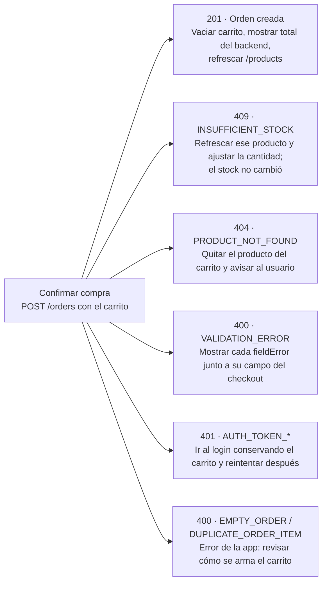

# Guía de integración del backend ShopLab para iOS y Android

Actualizado: 2026-10-14

El backend ya cubre todas las pantallas del MVP: catálogo, registro, login, perfil, checkout e historial de órdenes. Esta guía resume lo que cada app necesita para integrarse sin leer las specs ni el documento de arquitectura.

## Resumen y entornos

- **Base de la API:** `/api/v1`. JSON en UTF-8, campos y mensajes en inglés.
- **Moneda única:** USD. Los montos llegan como número JSON con 2 decimales (`59.99`, `25.00`).
- **Fechas:** `createdAt` y `termsAcceptedAt` en ISO-8601 UTC (`2026-10-11T15:04:05Z`, puede traer fracción). `birthDate` como `yyyy-MM-dd`.
- **Campos siempre presentes:** un valor opcional sin dato llega como `null`, nunca se omite. Las respuestas no traen campos extra.

| Desde | URL base | Nota de configuración en la app |
| --- | --- | --- |
| Emulador Android | `http://10.0.2.2:8080` | Permitir HTTP sin TLS para ese host (`network_security_config`) |
| Simulador iOS | `http://localhost:8080` | Excepción de App Transport Security para red local (`NSAllowsLocalNetworking`) |
| Dispositivo físico | `http://<IP del equipo>:8080` | Mismo equipo y red Wi-Fi; mismas excepciones de HTTP |

**Levantar el backend:** `docker compose up --build` en el repositorio del backend, con un `.env` copiado de `.env.example` (`DB_PASSWORD`, `JWT_SECRET` de al menos 32 caracteres). Arranca con el perfil `testing` y los datos semilla cargados.

**Referencia viva:**

- Swagger UI en `/swagger-ui.html`, con el botón *Authorize* para pegar el token.
- Especificación OpenAPI en `/v3/api-docs`, útil para generar clientes HTTP de Kotlin y Swift.
- Contratos JSON (draft-04) de cada respuesta en [`docs/contracts/`](docs/contracts/).
- IDs de accesibilidad comunes a iOS y Android en el [catálogo de IDs](catalogo-ids-accesibilidad.md).
- **Idioma de la UI:** inglés. Los textos sugeridos en esta guía están en inglés.

## Autenticación y sesión

La app obtiene un token con el login y lo envía en cada ruta protegida como `Authorization: Bearer <accessToken>`. No hay refresh token: cuando el token vence, el usuario vuelve a iniciar sesión.

- **Duración:** `expiresIn` en segundos. 900 (15 min) con el perfil `testing`, 3600 (1 h) en los demás.
- **Contenido del JWT (HS256):** `sub` (id del usuario), `email`, `iat`, `exp`. La app no necesita decodificarlo: el perfil se pide a `/users/me`.
- **Sin sesión en el servidor:** no hay cookies. Lo recomendable es guardar el token en el almacenamiento seguro (Keychain en iOS; en Android, Android Keystore con Tink, ya que `EncryptedSharedPreferences` está obsoleta desde `security-crypto` 1.1.0-alpha07). En su primera fase, la app iOS lo mantiene solo en memoria: al cerrarla hay que volver a iniciar sesión.
- **Logout:** solo local (borrar el token). El servidor no revoca tokens.

| Rutas | Token |
| --- | --- |
| `POST /auth/login`, `POST /users`, `GET /products`, `GET /products/{id}` | No hace falta. Si llega uno inválido, se ignora |
| `GET /users/me`, `POST /orders`, `GET /orders`, `GET /orders/{id}` | Obligatorio |

**Qué hacer ante cada 401 en una ruta protegida:**

| `code` | Significa | Acción en la app |
| --- | --- | --- |
| `AUTH_TOKEN_MISSING` | No se envió el token | Error de programación: revisar el interceptor. Volver al login sin el aviso de sesión expirada |
| `AUTH_TOKEN_MALFORMED` | El valor no es un JWT | Borrar el token e ir al login |
| `AUTH_TOKEN_INVALID` | Firma inválida o el usuario ya no existe | Borrar el token e ir al login |
| `AUTH_TOKEN_EXPIRED` | La sesión venció | Borrar el token e ir al login con el mensaje "Your session has expired. Please log in again." |

Centraliza este manejo en la capa de red (un interceptor de OkHttp/Ktor o de `URLSession`). Si más adelante se añade refresh token, solo cambiará esa pieza.

## Endpoints por pantalla

| Pantalla | Petición | Éxito | Errores a contemplar |
| --- | --- | --- | --- |
| Catálogo | `GET /products` | 200, array ordenado por `id` (6 productos, sin paginación) | — |
| Detalle de producto | `GET /products/{id}` | 200 | 404 `PRODUCT_NOT_FOUND` |
| Registro | `POST /users` | 201 con el usuario creado | 400, 409 `EMAIL_ALREADY_EXISTS`, 422 `UNDERAGE_USER` / `TERMS_NOT_ACCEPTED` |
| Login | `POST /auth/login` | 200 con el token | 400, 401 `INVALID_CREDENTIALS`, 423 `USER_LOCKED` |
| Perfil | `GET /users/me` | 200 con el usuario | 401 |
| Checkout | `POST /orders` | 201 con la orden | 400, 401, 404, 409 (ver *Simulación de la compra*) |
| Mis órdenes | `GET /orders` | 200, de la más reciente a la más antigua | 401 |
| Detalle de orden | `GET /orders/{id}` | 200 | 401, 404 `ORDER_NOT_FOUND` (también si es de otro usuario) |

### Producto

```json
{ "id": 1, "sku": "SL-HEAD-001", "name": "Wireless Headphones",
  "description": "Over-ear bluetooth headphones", "price": 59.99, "stock": 10, "imageKey": "headphones" }
```

`stock` = 0 significa agotado: deshabilita el botón "Add to cart" y muestra la etiqueta "Sold out".

### Registro: reglas de cada control del formulario

Valida en la app para dar respuesta inmediata, pero el backend es la última palabra: muestra siempre sus `fieldErrors`.

| Campo (control) | Regla | Mensaje del backend si falla |
| --- | --- | --- |
| `firstName`, `lastName` (text field) | Obligatorio, 2 a 50 caracteres | `must not be blank` / `size must be between 2 and 50` |
| `email` (text field) | Obligatorio, formato email, máx. 100. Se guarda en minúsculas y sin espacios | `must be a well-formed email address` |
| `password` (password field) | 8 a 20 caracteres ASCII visibles, sin espacios ni tildes, con mayúscula, minúscula, número y especial | `must contain at least one uppercase letter, one lowercase letter, one number and one special character, without spaces` |
| `phone` (text field numérico) | Opcional; si se envía, 7 a 15 dígitos. Si está vacío, **no lo envíes** (`""` es inválido) | `must contain only digits (7 to 15)` |
| `birthDate` (DatePicker) | Obligatorio, `yyyy-MM-dd`, en el pasado; mayor de 18 años (UTC) | `must be a date in the past` / 422 `UNDERAGE_USER` |
| `country` (dropdown) | `US`, `CO`, `MX`, `ES`, `AR`, `CL` o `PE` | `must be one of: US, CO, MX, ES, AR, CL, PE` |
| `plan` (radio buttons) | `BASIC` o `PRO` | `must be one of: BASIC, PRO` |
| `experienceLevel` (slider) | Entero de 1 a 5 | `must be between 1 and 5` |
| `newsletter` (switch) | Opcional, `false` por defecto | — |
| `termsAccepted` (checkbox) | Obligatorio y debe ser `true` | 422 `TERMS_NOT_ACCEPTED` |

El orden de evaluación es: formato de los campos (400, todos los errores juntos), edad (422), términos (422) y email duplicado (409).

### Login

```json
// POST /auth/login
{ "email": "standard@shoplab.dev", "password": "Secret_123" }
// 200
{ "accessToken": "eyJhbGciOi...", "tokenType": "Bearer", "expiresIn": 900 }
```

El login solo exige que los campos no estén vacíos. Cualquier credencial incorrecta, incluido un email mal escrito, responde el mismo 401 `INVALID_CREDENTIALS`: muestra un único mensaje genérico. El 423 `USER_LOCKED` solo aparece con la contraseña correcta.

### Perfil (`GET /users/me`)

Devuelve el mismo objeto que el registro: `id`, `email`, `firstName`, `lastName`, `phone` (puede ser `null`), `birthDate`, `country`, `plan`, `experienceLevel`, `newsletter`, `status`, `termsAcceptedAt`, `createdAt`. Nunca incluye la contraseña. No hay endpoint para editar el perfil.

## Errores y cómo mostrarlos

Todo error (4xx y 5xx) llega con el mismo formato, así que basta con un único parser de errores en cada app. Decide qué mostrar por `code`, nunca por el texto de `message`.

```json
{
  "timestamp": "2026-10-11T15:04:05Z",
  "status": 400,
  "code": "VALIDATION_ERROR",
  "message": "Request has invalid fields",
  "path": "/api/v1/users",
  "fieldErrors": [
    { "field": "email", "message": "must be a well-formed email address" }
  ]
}
```

- **`fieldErrors`** solo trae elementos con `VALIDATION_ERROR`; en el resto es `[]`. Muestra cada uno debajo de su control usando `field` (`email`, `shipping.city`, `items[0].quantity`). Un campo puede tener dos mensajes.
- **`message`** está en inglés, es fijo y técnico. Úsalo solo para logs: el texto que ve el usuario sale de la tabla siguiente, mapeado desde `code`.
- **`VALIDATION_ERROR` con `fieldErrors` vacío** y `message` `Malformed JSON request` indica un body mal construido por la app: es un error de programación, no del usuario.

| `code` | HTTP | Mensaje para el usuario (UI en inglés) | Dónde se muestra |
| --- | --- | --- | --- |
| `VALIDATION_ERROR` | 400 | "Some fields need your attention." + los `fieldErrors`, uno debajo de cada campo | Resumen y en el formulario |
| `INVALID_CREDENTIALS` | 401 | "The email or password is incorrect." | Login |
| `USER_LOCKED` | 423 | "Your account is locked. Please contact support." | Login |
| `EMAIL_ALREADY_EXISTS` | 409 | "An account with this email already exists." | Campo email |
| `UNDERAGE_USER` | 422 | "You must be at least 18 years old to register." | Campo fecha de nacimiento |
| `TERMS_NOT_ACCEPTED` | 422 | "You must accept the terms and conditions." | Checkbox de términos |
| `PRODUCT_NOT_FOUND` | 404 | "This product is no longer available." | Detalle o checkout |
| `INSUFFICIENT_STOCK` | 409 | "Some products in your cart don't have enough stock. Please update the quantities." | Checkout (y refrescar el stock) |
| `EMPTY_ORDER` | 400 | "Your cart is empty." | Checkout |
| `DUPLICATE_ORDER_ITEM` | 400 | "We couldn't process your cart. Please try again." (es un error de la app: agrupa cantidades por producto) | Checkout |
| `ORDER_NOT_FOUND` | 404 | "We couldn't find this order." | Detalle de orden |
| `AUTH_TOKEN_*` | 401 | Ver *Autenticación y sesión* | Login |
| `METHOD_NOT_ALLOWED`, `UNSUPPORTED_MEDIA_TYPE`, `NOT_FOUND` | 405, 415, 404 | "Something went wrong. Please try again." (es un error de la app: método, `Content-Type` o ruta) | Alerta |
| `INTERNAL_ERROR` y cualquier 5xx | 500+ | "Something went wrong on our side. Please try again later." | Alerta |
| `FORCED_ERROR` | El de la cabecera | El mensaje genérico de su familia (4xx o 5xx) | Alerta |

Los mensajes con un id lo incluyen (`Insufficient stock for product 5`), pero no se interpretan: con varios productos en el pedido, el mensaje general y un refresco del stock bastan para que el usuario vea qué ajustar.

## Manejo de imágenes

El backend no sirve imágenes ni URLs: cada producto trae un `imageKey` y cada app lleva las imágenes empaquetadas, buscadas por esa clave. Es una decisión del MVP (servir imágenes queda para la fase 2).

| `imageKey` | Producto | Recurso (Android `res/drawable` e iOS Asset Catalog) |
| --- | --- | --- |
| `headphones` | Wireless Headphones | `product_headphones` |
| `keyboard` | Mechanical Keyboard | `product_keyboard` |
| `smartwatch` | Smart Watch | `product_smartwatch` |
| `mouse` | Gaming Mouse | `product_mouse` |
| `speaker` | Bluetooth Speaker | `product_speaker` |
| `backpack` | Laptop Backpack | `product_backpack` |

Las dos plataformas usan el mismo nombre en `snake_case`, que además es válido como recurso de Android. Lo importante es que el mapeo `imageKey` → recurso viva en **un solo lugar** de cada app (un enum o un diccionario), no repartido por las pantallas.

- **Clave desconocida:** si llega un `imageKey` que la app no tiene, muestra una imagen genérica (`product_placeholder`). Nunca debe fallar ni quedar vacío.
- **Formato:** imágenes cuadradas, en vectorial o con las densidades de cada plataforma (`@2x`, `@3x`; `mdpi`…`xxxhdpi`).
- **Mismas claves en todas partes:** catálogo, detalle, carrito y los ítems de las órdenes (`items[].imageKey`) usan la misma clave.
- **Automatización:** la imagen lleva el ID `product_image_<imageKey>` (`product_image_headphones`), dentro del contenedor de su fila, para que Appium y Maestro comprueben que se muestra la imagen correcta. Ver el [catálogo de IDs](catalogo-ids-accesibilidad.md).
- **Agotado:** con `stock` 0, superpone la etiqueta "Sold out" sobre la imagen en lugar de cambiar de recurso.

## Simulación de la compra

No hay pasarela de pago: una compra es un único `POST /orders` que descuenta el stock y crea la orden en estado `CONFIRMED` al instante. La forma de pago solo se registra; **la app nunca debe pedir ni enviar datos reales de tarjeta**.

### Qué vive en la app y qué en el backend

| Responsabilidad | Dónde |
| --- | --- |
| Carrito (productos, cantidades) y su persistencia entre aperturas de la app | App (local, no hay carrito en el servidor) |
| Total estimado mientras se compra | App, con los precios del catálogo |
| Precio final, subtotales y total | Backend: ignora cualquier precio o total que envíe la app |
| Validar y descontar stock sin sobreventa | Backend, de forma atómica |
| Forma de pago (`CARD`, `CASH`, `TRANSFER`) | App la elige; el backend solo la guarda |
| Dirección de envío | App la pide; el backend la copia en la orden |

### Flujo recomendado

1. **Catálogo y carrito.** Limita la cantidad por producto a 1–99 y al `stock` mostrado. Un producto aparece una sola vez en el carrito: sumar más unidades aumenta su cantidad (dos líneas del mismo producto provocan `DUPLICATE_ORDER_ITEM`).
2. **Checkout.** Pide la dirección y la forma de pago. Si eliges simular la pantalla de tarjeta, que sea visual: no se envía nada de ella.
3. **Confirmar.** Envía el carrito completo:

```json
// POST /api/v1/orders   Authorization: Bearer <token>
{
  "items": [ { "productId": 1, "quantity": 2 }, { "productId": 4, "quantity": 1 } ],
  "paymentMethod": "CARD",
  "shipping": { "address": "Calle 10 #20-30", "city": "Bogotá", "postalCode": "110111", "country": "CO" }
}
```

4. **Mostrar el resultado con los datos del backend**, no con los del carrito: `total`, `items[].unitPrice` y `items[].subtotal` de la respuesta.

```json
// 201
{ "id": 3, "status": "CONFIRMED", "paymentMethod": "CARD",
  "items": [ { "productId": 1, "sku": "SL-HEAD-001", "name": "Wireless Headphones", "imageKey": "headphones",
               "quantity": 2, "unitPrice": 59.99, "subtotal": 119.98 },
             { "productId": 4, "sku": "SL-MOUS-004", "name": "Gaming Mouse", "imageKey": "mouse",
               "quantity": 1, "unitPrice": 25.00, "subtotal": 25.00 } ],
  "total": 144.98,
  "shipping": { "address": "Calle 10 #20-30", "city": "Bogotá", "postalCode": "110111", "country": "CO" },
  "createdAt": "2026-10-14T15:04:05Z" }
```

5. **Tras el 201**, vacía el carrito y vuelve a pedir `GET /products` para refrescar el stock.

### Reglas del body de la orden

| Campo | Regla | `field` en el error |
| --- | --- | --- |
| `items` | Lista no nula, sin elementos nulos. Vacía → `EMPTY_ORDER` | `items`, `items[0]` |
| `productId`, `quantity` | Obligatorios; `quantity` de 1 a 99 | `items[0].quantity` |
| `paymentMethod` | `CARD`, `CASH` o `TRANSFER` | `paymentMethod` |
| `shipping.address` | 5 a 120 caracteres | `shipping.address` |
| `shipping.city` | 2 a 60 caracteres | `shipping.city` |
| `shipping.postalCode` | 3 a 10 letras, dígitos, espacios o guiones (`110111`, `SW1A 1AA`) | `shipping.postalCode` |
| `shipping.country` | La misma lista del registro | `shipping.country` |

Si la orden falla, el backend no descuenta stock de ningún producto: el usuario puede corregir el carrito y reintentar. Si varios ítems fallan, el error señala el primero según el orden enviado.

### Qué hace la app con cada respuesta de `POST /orders`



Solo el 201 vacía el carrito. En cualquier error el carrito se conserva, para que el usuario corrija y vuelva a confirmar.

## Utilidades del perfil testing

Con el perfil `testing`, el que usa `docker compose` por defecto, el backend ofrece herramientas para las suites de Appium, Maestro o RestAssured. Ninguna exige token. En otros perfiles, `/api/v1/test/**` responde 404 y las cabeceras se ignoran.

| Utilidad | Uso | Respuesta |
| --- | --- | --- |
| `POST /api/v1/test/reset` | Antes de cada suite: vuelve a los datos semilla y reinicia los ids | 204 sin body |
| `POST /api/v1/test/tokens/expired` con `{"email": "..."}` | Probar la pantalla de sesión expirada sin esperar 15 min | 200 `{"accessToken", "tokenType": "Bearer"}`; 404 `USER_NOT_FOUND` |
| Cabecera `X-Delay: 3000` | Probar spinners, timeouts y esperas | Retrasa la respuesta esos ms, máximo 10000 |
| Cabecera `X-Force-Error: 503` | Probar pantallas de error | Responde ese status (400–599) con `code` `FORCED_ERROR`, sin ejecutar la petición |

- **Las cabeceras funcionan en cualquier ruta, incluso sin token:** `X-Force-Error: 418` en `/users/me` responde 418, no 401. Si llegan juntas, primero espera y luego falla.
- **Valores inválidos se ignoran:** `X-Delay: abc` o `-5`, `X-Force-Error: 200` o `700`.
- **Desde la app:** para usarlas en una build de pruebas, añade un interceptor o un menú de depuración que inyecte estas cabeceras. No las incluyas en la build de producción.
- **Tras un reset**, los tokens anteriores pueden apuntar a otro usuario con el mismo id: pide tokens nuevos.

## Datos semilla para pruebas

Estos datos existen al arrancar en cualquier perfil y vuelven tras cada `/test/reset`. La contraseña de los tres usuarios es `Secret_123`.

| id | Usuario | Estado | Para probar |
| --- | --- | --- | --- |
| 1 | `standard@shoplab.dev` | ACTIVE | Flujo feliz; no tiene órdenes |
| 2 | `locked@shoplab.dev` | LOCKED | Login bloqueado (423) |
| 3 | `buyer@shoplab.dev` | ACTIVE | Historial con 2 órdenes |

| id | Producto | Precio (USD) | Stock | `imageKey` | Para probar |
| --- | --- | --- | --- | --- | --- |
| 1 | Wireless Headphones | 59.99 | 10 | `headphones` | Compra normal |
| 2 | Mechanical Keyboard | 89.90 | 15 | `keyboard` | Compra normal |
| 3 | Smart Watch | 149.00 | 0 | `smartwatch` | Producto agotado, 409 al comprar |
| 4 | Gaming Mouse | 25.00 | 20 | `mouse` | Precio con `.00` |
| 5 | Bluetooth Speaker | 39.50 | 1 | `speaker` | Última unidad: la segunda compra da 409 |
| 6 | Laptop Backpack | 45.00 | 8 | `backpack` | Compra normal |

| Orden | Usuario | Pago | Fecha | Ítems | Total (USD) |
| --- | --- | --- | --- | --- | --- |
| 2 | buyer | CASH | 2026-09-15 | producto 6 × 1 | 45.00 |
| 1 | buyer | CARD | 2026-09-01 | producto 1 × 1 + producto 4 × 2 | 109.99 |

Un usuario registrado por las pruebas recibe el id 4 si se hizo un reset justo antes.

## Limitaciones y checklist

**Lo que el backend no ofrece todavía (fase 2):** refresh token, logout en el servidor, edición de perfil, cambio y recuperación de contraseña, cancelación de órdenes, paginación, roles de administrador, carrito en el servidor, imágenes servidas por la API y pagos reales. Las apps no deben mostrar opciones que dependan de estas funciones.

**Checklist para cada app:**

- [ ] URL base configurable por entorno (emulador, simulador, dispositivo) y excepciones de HTTP para desarrollo
- [ ] Cliente HTTP con `Content-Type: application/json` y un parser único del formato de error
- [ ] Token en almacenamiento seguro e interceptor que añade `Authorization` y gestiona los 401
- [ ] Formulario de registro con las reglas de cada control y `fieldErrors` mostrados por campo
- [ ] `phone` omitido cuando está vacío; email sin espacios
- [ ] Mensaje de login genérico para `INVALID_CREDENTIALS` y pantalla específica para `USER_LOCKED`
- [ ] Mapeo único `imageKey` → recurso con imagen de respaldo
- [ ] Productos con `stock` 0 marcados como agotados y no añadibles
- [ ] Carrito local persistente, una línea por producto, cantidad de 1 a 99
- [ ] Checkout sin datos reales de tarjeta; confirmación con los importes de la respuesta
- [ ] Manejo de cada respuesta de `POST /orders` como en el diagrama de *Simulación de la compra*
- [ ] Montos en tipo decimal (`BigDecimal` en Kotlin, `Decimal` en Swift), nunca `Double`, formateados como USD
- [ ] Identificadores de accesibilidad del [catálogo de IDs](catalogo-ids-accesibilidad.md) en todos los controles
- [ ] En builds de prueba, forma de inyectar `X-Delay` y `X-Force-Error`
