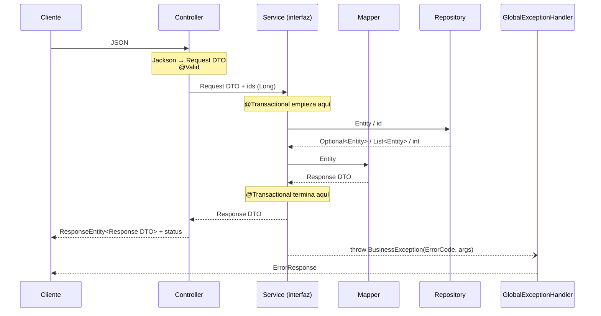

# Design

## Context

Proyecto nuevo: solo existen `docs/shop-backend-arquitectura.md` (fuente de verdad) y `docs/contracts/`. Ver `proposal.md` para la motivación.

Este change no crea features de negocio, pero fija el **contrato entre capas** que todas van a seguir. Por eso la mayor parte de este documento lo describe, y la prueba de arquitectura lo hace obligatorio.

## Goals / Non-Goals

**Goals:**
- Dejar escrito y verificado por tests qué tipo de objeto cruza cada frontera entre capas, quién lanza y quién traduce las excepciones, y dónde empiezan las transacciones.
- Dejar el `GlobalExceptionHandler` completo y probado **antes** de la primera feature, para que cada feature solo lance `BusinessException`.
- Arrancar con `docker compose up --build` y tener datos semilla listos.

**Non-Goals:**
- Entidades, repositories, services y controllers de negocio: llegan con cada feature (`product-catalog`, `user-registration`…).
- JWT: `JwtProperties`, `JwtService` y el filtro llegan en `auth-login` y `auth-jwt-filter`. Aquí solo se declara la dependencia `jjwt`.
- Utilidades del perfil `testing` (`/test/reset`, `ChaosFilter`): llegan en `testing-profile`.

## Decisions

### D1. Contrato de comunicación entre capas



Qué cruza cada frontera:

| Frontera | Entra | Sale | Prohibido |
|---|---|---|---|
| HTTP → Controller | Request DTO (`record`) validado con `@Valid`; variables de ruta (`Long id`); `AuthUser` (desde `auth-jwt-filter`) | `ResponseEntity<ResponseDTO>` con su status HTTP | Entidades, `Map<String,Object>`, `try/catch` |
| Controller → Service | Request DTO e ids primitivos (`Long userId`) | Response DTO, `List<ResponseDTO>` o nada | `HttpServletRequest`, `ResponseEntity`, `AuthUser`, entidades |
| Service → Repository | Entidades e ids | `Optional<Entity>`, `List<Entity>`, `boolean`, `int` (`@Modifying`) | DTOs |
| Service → Mapper | Entidad | Response DTO | Reglas de negocio en el mapper |
| Service → Controller (error) | — | `BusinessException(ErrorCode, args)` | Devolver `null` u `Optional` para indicar "no existe" |

Reglas que se derivan:

1. **El service recibe `Long userId`, no `AuthUser`.** Así el service no depende de `security` y se prueba sin Spring Security. El controller hace `user.id()`.
2. **El service nunca devuelve `Optional` ni `null`.** Si algo no existe, lanza `BusinessException(ErrorCode.X_NOT_FOUND, id)`. El controller no tiene `if`.
3. **El mapper solo va en una dirección: Entity → Response DTO.** La entidad nueva la construye el service, porque necesita datos que no vienen en el request (`passwordHash`, `createdAt` con `Clock`, `status`). *Alternativa descartada:* un `toEntity(request)` en el mapper, que acaba mezclando reglas de negocio con conversión.
4. **El mapper es un `@Component` sin dependencias**, inyectado por constructor. En los tests unitarios del service se usa la instancia real (`new ProductMapper()`), no un mock. *Alternativa descartada:* métodos `static`, porque mezclar estáticos con inyección confunde a un junior.
5. **Las transacciones empiezan y terminan en el `ServiceImpl`.** Ni el controller ni el repository declaran `@Transactional`. El mapper se llama dentro de la transacción (§11, regla 1).
6. **Las excepciones no se capturan en el controller.** Viajan hasta el `GlobalExceptionHandler`. El único `try/catch` permitido en un service es para traducir una excepción técnica a un `ErrorCode`, como en el caso del email duplicado (§6.4).
7. **Acceso entre features**: solo el que lista §3.3 del documento de arquitectura (de `ServiceImpl` a un repository de otra feature).

### D2. El contrato se verifica con ArchUnit

Hay una sola clase de test, `ArchitectureTest`, con estas reglas:

| Regla | Evita |
|---|---|
| Las clases `*Controller` no dependen de `*Repository` ni de `*ServiceImpl` | Saltarse el service, o atarse a la implementación |
| Ni los `*Controller` ni las clases del paquete `..dto..` dependen de clases `@Entity` | Que una entidad salga del service |
| Los `*Repository` no dependen de `*Service` | Dependencias hacia arriba |
| `common` no depende de ningún paquete de feature | Que el núcleo compartido conozca las features |
| Ninguna clase usa inyección por campo (`@Autowired` en atributos) | Clases imposibles de probar sin Spring |
| Los `*Controller` no tienen métodos anotados con `@Transactional` | Transacciones fuera del service |

En el bootstrap todavía no hay clases que cumplan los patrones, así que las reglas se declaran con `.allowEmptyShould(true)`. Empiezan a "morder" en `product-catalog`.

*Alternativa descartada:* revisarlo solo en code review. ArchUnit avisa en `./gradlew test`, que es justo cuando un junior lo necesita, a cambio de una dependencia y unos 60 líneas de test.

### D3. `ErrorCode` completo desde el inicio

Se crean **todos** los valores de §9.1, aunque algunas features aún no existan, para que el enum coincida desde el primer día con `docs/contracts/error-response.schema.json`. Un test recorre el enum y verifica que cada nombre está en el `enum` del esquema y al revés. Así, si alguien agrega un código, el test lo obliga a actualizar el contrato.

### D4. Probar el handler sin features: controller de prueba

El `GlobalExceptionHandler` se prueba con `@WebMvcTest` contra un `ErrorHandlingTestController` que vive en `src/test`, nunca en `src/main`. Sus endpoints:
- `POST /test-errors/body`: recibe un DTO con `String` obligatorio, email, enum, `LocalDate`, `Boolean`, `Integer` y una lista anidada con `@Valid`.
- `GET /test-errors/items/{id}`: recibe un `Long` en la ruta.
- `GET /test-errors/business`: lanza una `BusinessException` con argumento.
- `GET /test-errors/boom`: lanza una `RuntimeException`.

Así cada escenario de `specs/error-handling` tiene un test sin depender de otras features.

### D5. Handler, Jackson y reloj

- `GlobalExceptionHandler` se implementa tal cual §9.3 y **no** extiende `ResponseEntityExceptionHandler`.
- Jackson estricto con `spring.jackson.mapper.allow-coercion-of-scalars=false` y `spring.jackson.deserialization.accept-float-as-int=false`. Hay un test por cada caso de la spec, porque estas propiedades son la parte más frágil ante cambios de versión.
- `ClockConfig` expone `Clock.systemUTC()`. `ErrorResponse.timestamp` usa `Instant.now()`, porque no es una regla de negocio y no hace falta probarlo con un reloj fijo.

### D6. `SecurityConfig` provisional

Usa el código de §16 del documento: todo público, stateless, sin CSRF, más el bean `PasswordEncoder` (BCrypt). El change `auth-jwt-filter` lo reemplaza. Con esto, `/actuator/health`, Swagger y las rutas inexistentes (404) responden sin token.

### D7. Migraciones y datos semilla

- **V1–V3** crean las tablas con las longitudes de §6.6, ids `bigint generated by default as identity`, `UNIQUE (email)`, `UNIQUE (sku)`, `CHECK (stock >= 0)`, `CHECK (price >= 0)`, `CHECK (quantity > 0)`, `CHECK (experience_level BETWEEN 1 AND 5)` y claves foráneas `orders.user_id`, `order_items.order_id` y `order_items.product_id`.
- **V4** inserta los datos **sin escribir los ids**, en un orden fijo. Si se insertara `id = 1` a mano, la secuencia de identidad no avanzaría y el primer registro creado por la API chocaría con el id 1. Con la base vacía, o tras `TRUNCATE ... RESTART IDENTITY`, el orden de inserción garantiza los ids 1, 2, 3…
- V4 no usa sentencias propias de Flyway, porque `/test/reset` lo volverá a ejecutar.
- El hash BCrypt de `Secret_123` se genera una vez con `BCryptPasswordEncoder` (coste 10) y se pega en V4. Un test de integración verifica que el hash corresponde a `Secret_123`.

Productos semilla:

| id | sku | name | price | stock | imageKey |
|---|---|---|---|---|---|
| 1 | `SL-HEAD-001` | Wireless Headphones | 59.99 | 10 | `headphones` |
| 2 | `SL-KEYB-002` | Mechanical Keyboard | 89.90 | 15 | `keyboard` |
| 3 | `SL-WATC-003` | Smart Watch | 149.00 | **0** | `smartwatch` |
| 4 | `SL-MOUS-004` | Gaming Mouse | 25.00 | 20 | `mouse` |
| 5 | `SL-SPKR-005` | Bluetooth Speaker | 39.50 | **1** | `speaker` |
| 6 | `SL-BACK-006` | Laptop Backpack | 45.00 | 8 | `backpack` |

Usuarios semilla (todos con `Secret_123`, `country` `CO`, `plan` `BASIC`, `experience_level` 3, `newsletter` `false`, `phone` `NULL` y `terms_accepted_at` igual a `created_at`):

| id | email | first_name | last_name | birth_date | status |
|---|---|---|---|---|---|
| 1 | `standard@shoplab.dev` | Standard | User | 1990-05-20 | ACTIVE |
| 2 | `locked@shoplab.dev` | Locked | User | 1988-03-15 | LOCKED |
| 3 | `buyer@shoplab.dev` | Buyer | User | 1995-11-02 | ACTIVE |

Órdenes semilla de `buyer` (`CONFIRMED`; no descuentan stock, porque el stock de la tabla de productos ya es el actual):

| id | payment_method | created_at | ítems (product_id × quantity @ unit_price) | total |
|---|---|---|---|---|
| 1 | `CARD` | 2026-09-01T10:00:00Z | 1 × 1 @ 59.99; 4 × 2 @ 25.00 | 109.99 |
| 2 | `CASH` | 2026-09-15T16:30:00Z | 6 × 1 @ 45.00 | 45.00 |

Dirección de envío de ambas órdenes: `Calle 10 #20-30`, `Bogotá`, `110111`, `CO`.

### D8. Configuración y perfiles

| Archivo | Contenido |
|---|---|
| `application.yml` | Datasource por variables de entorno, JPA (§11.1), Jackson estricto, Flyway, Actuator (`exposure.include=health`, `show-details=never`, `show-components=never`), springdoc en `/swagger-ui.html` |
| `application-dev.yml` | `spring.jpa.show-sql=true` y datasource `localhost:5432` |
| `application-testing.yml` | Vacío por ahora; lo completan `auth-login` (TTL de 15 min) y `testing-profile` |

### D9. Infraestructura de pruebas

- **Testcontainers** con `@ServiceConnection` y un `PostgreSQLContainer("postgres:16")` compartido. Se define en una clase base `IntegrationTest` en `src/test/java/com/shoplab/api/support/`, que **no** es el paquete `testsupport` de `src/main`.
- Versiones: la última Spring Boot **3.5.x** estable; jjwt, springdoc-openapi 2.8.x y ArchUnit 1.x se fijan en `build.gradle.kts`. Testcontainers usa la versión que gestiona Spring Boot.

### D10. Build con Gradle (Kotlin DSL y wrapper)

- `settings.gradle.kts` con `rootProject.name = "shop-backend"` y `build.gradle.kts` con los plugins `org.springframework.boot`, `io.spring.dependency-management` y `java`, y `java { toolchain { languageVersion = JavaLanguageVersion.of(21) } }`.
- **Gradle Wrapper** versionado en el repo (`gradlew`, `gradlew.bat`, `gradle/wrapper/`). Todos los comandos usan `./gradlew`, así nadie necesita instalar Gradle y todos usan la misma versión.
- Dos tareas de test sobre el mismo `src/test`:

```kotlin
tasks.test {
    useJUnitPlatform()
    exclude("**/*IT.class")                 // rápidos, sin Docker
}

val integrationTest by tasks.registering(Test::class) {
    description = "Tests de integración con Testcontainers (*IT)"
    group = "verification"
    useJUnitPlatform()
    testClassesDirs = sourceSets.test.get().output.classesDirs
    classpath = sourceSets.test.get().runtimeClasspath
    include("**/*IT.class")
    shouldRunAfter(tasks.test)
}

tasks.check { dependsOn(integrationTest) }

tasks.bootJar { archiveFileName.set("app.jar") }
tasks.jar { enabled = false }                // evita el "-plain.jar" junto al ejecutable
```

- Un test concreto se ejecuta con `./gradlew test --tests ArchitectureTest` o `./gradlew integrationTest --tests SeedDataIT`.

*Alternativa descartada:* un *source set* separado `src/integrationTest`. Es más "correcto", pero obliga a configurar dependencias y carpetas aparte. Para un junior basta con la convención de sufijo `*IT`.

*Alternativa descartada:* Groovy DSL (`build.gradle`). Kotlin DSL es la opción por defecto en Gradle 8 y el IDE autocompleta y marca errores al escribirlo.

## Risks / Trade-offs

- [`@WebMvcTest` no carga `SecurityConfig` y Spring aplicaría su seguridad por defecto, que responde 401] → Los tests web hacen `@Import(SecurityConfig.class)`.
- [Las reglas de ArchUnit sin clases pasan sin comprobar nada] → Es lo esperado en el bootstrap. `product-catalog` debe ver la prueba fallar al menos una vez (por ejemplo, inyectando un repository en el controller) para confirmar que la regla funciona.
- [Testcontainers necesita Docker en la máquina del desarrollador] → Se documenta en el README. `./gradlew test` no lo necesita; solo `integrationTest` y `check`.
- [Gradle genera dos jars (`app.jar` y `-plain.jar`) y el `COPY` del Dockerfile sería ambiguo] → `bootJar` con nombre fijo y `jar` desactivado (D10).
- [Una nueva versión de Jackson podría cambiar el efecto de `allow-coercion-of-scalars`] → Hay un test explícito por cada caso de coerción.
- [Con la seguridad provisional todo es público] → Solo dura hasta `auth-jwt-filter`, y antes de ese change no hay endpoints con datos privados.
- [El orden de inserción de V4 define los ids] → El test de semilla verifica ids, emails y SKUs.

## Migration Plan

Proyecto nuevo, no hay nada que migrar. Para volver atrás en local: `docker compose down -v` borra el volumen y la base de datos.

## Open Questions

- Las descripciones de los productos son textos cortos en inglés; se pueden ajustar en V4 antes de archivar sin cambiar ninguna spec.
