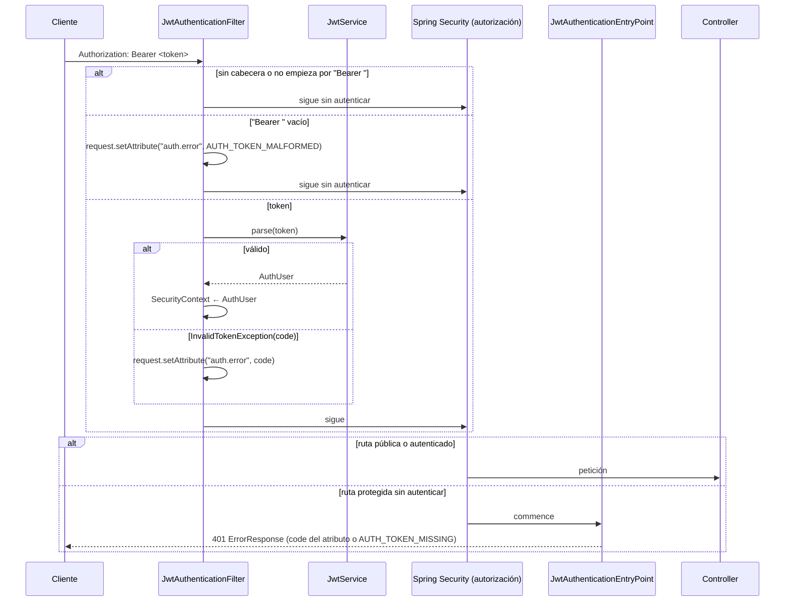

# Design

## Context

- `security/SecurityConfig` es provisional: `anyRequest().permitAll()`, stateless, sin CSRF, con el bean `PasswordEncoder`.
- `JwtService` solo tiene `generateToken`; `JjwtService` firma con HS256 y un `Clock` inyectado. `JwtProperties` exige el secreto al arrancar.
- `ErrorCode` ya tiene `AUTH_TOKEN_MISSING`, `AUTH_TOKEN_MALFORMED`, `AUTH_TOKEN_INVALID`, `AUTH_TOKEN_EXPIRED` y `ACCESS_DENIED`; `error-response.schema.json` también.
- `OpenApiConfig` declara el esquema `bearerAuth`.
- Cuatro `@WebMvcTest` importan `SecurityConfig` (`ProductControllerTest`, `UserControllerTest`, `AuthControllerTest`, `GlobalExceptionHandlerTest`). `GlobalExceptionHandlerTest` prueba el handler en `/test-errors/**` y en `/api/v1/does-not-exist`, que dejarán de ser públicas. `HealthIT` espera 404 en `/actuator/env`.
- §7.1, §8.2 y §8.4 de `docs/shop-backend-arquitectura.md` fijan las rutas públicas, el mapeo de excepciones de jjwt y el flujo del entry point.

Ver `proposal.md` para la motivación y las specs `token-authentication`, `user-profile`, `error-handling` y `service-health` para el comportamiento.

## Goals / Non-Goals

**Goals:**
- Un único punto que decide si una ruta es pública (`SecurityConfig`) y un único punto que escribe los 401 (`JwtAuthenticationEntryPoint`), con el mismo `ErrorResponse` que el resto de la API.
- jjwt sigue aislado en `JjwtService`; el filtro solo conoce `JwtService` e `InvalidTokenException`.

**Non-Goals:**
- Roles y autorización por permisos: no hay roles; `JsonAccessDeniedHandler` existe "por si acaso" (§4) y solo se prueba de forma unitaria.
- Comprobar en la BD, en cada petición, que el usuario sigue existiendo o activo (limitación aceptada de §8.4). Solo `GET /users/me` lo comprueba porque necesita leer el usuario.
- `ChaosFilter` y `/test/**` (`testing-profile`).

## Decisions

### D1. Clases nuevas y flujo

```
security/
├── AuthUser.java                     ← record (Long id, String email): el principal autenticado
├── InvalidTokenException.java        ← RuntimeException con un ErrorCode AUTH_TOKEN_*
├── JwtAuthenticationFilter.java      ← OncePerRequestFilter (NO es @Component, ver D3)
├── JwtAuthenticationEntryPoint.java  ← @Component: escribe el 401 en JSON
├── JsonAccessDeniedHandler.java      ← @Component: escribe el 403 en JSON
└── SecurityConfig.java               ← definitivo (§7.1)
```



- **El filtro nunca responde por sí mismo**: solo autentica o deja un atributo. Así una ruta pública con un token roto sigue funcionando (spec *El token no afecta a las rutas públicas*), y la decisión de rechazar la toma solo Spring Security con las reglas de `SecurityConfig`.
- **`Bearer` a secas cuenta como `Bearer ` vacío** (`AUTH_TOKEN_MALFORMED`). Por HTTP real, el cliente o Tomcat recortan los espacios finales de la cabecera (RFC 7230), así que `Bearer ` llega como `Bearer`. MockMvc no recorta, por eso solo `TokenAuthenticationIT` lo detectó. `BearerXYZ` y `bearer abc` siguen siendo `AUTH_TOKEN_MISSING`.
- El nombre del atributo es una constante pública `JwtAuthenticationFilter.AUTH_ERROR_ATTRIBUTE = "auth.error"`, que lee el entry point.

### D2. `JwtService.parse` en `JjwtService`

Se implementa tal como está en §8.2, con dos precisiones:

- El parser usa el `Clock` inyectado (`.clock(() -> Date.from(clock.instant()))`) para decidir si el token expiró. Así un test puede crear un token con un reloj en el pasado y comprobar `AUTH_TOKEN_EXPIRED` sin esperar.
- `sub` no numérico → `NumberFormatException` (es un `IllegalArgumentException`) → `AUTH_TOKEN_INVALID`. Si falta `sub` o `email` se lanza `InvalidTokenException(AUTH_TOKEN_INVALID)` explícitamente, en lugar de crear un `AuthUser` con `null`.
- Orden de los `catch`: `ExpiredJwtException` → `MalformedJwtException` → `JwtException | IllegalArgumentException`, porque las dos primeras heredan de `JwtException`.

### D3. El filtro no es un bean

`SecurityConfig` crea el filtro con `new JwtAuthenticationFilter(jwtService)` y lo añade con `addFilterBefore(..., UsernamePasswordAuthenticationFilter.class)`. *Alternativa descartada:* anotarlo con `@Component`. Spring Boot registra automáticamente todo `Filter` que sea bean como filtro de servlet, así que se ejecutaría **dos veces** (una en la cadena de seguridad y otra fuera). Además, los `@WebMvcTest` cargan todos los beans `Filter`, así que lo cargarían también sin `JwtService` y fallarían.

### D4. `SecurityConfig` definitivo

Se copia el de §7.1, con:
- `.exceptionHandling(e -> e.authenticationEntryPoint(entryPoint).accessDeniedHandler(accessDeniedHandler))`.
- `"/api/v1/users"` es una ruta exacta en `requestMatchers`, así que `/api/v1/users/me` queda protegida.
- `"/api/v1/products", "/api/v1/products/**"` son públicas para **todos los métodos**: así `DELETE /products/1` llega al controller y responde 405 en lugar de 401.
- Sigue declarando el bean `PasswordEncoder` y el `httpBasic` / `formLogin` desactivados.

### D5. El entry point y el handler de 403 escriben el mismo `ErrorResponse`

Usan el `ObjectMapper` de Spring (inyectado) para escribir `new ErrorResponse(Instant.now(), 401, code.name(), code.getMessage(), request.getRequestURI(), List.of())` con `Content-Type: application/json`. El `timestamp` usa `Instant.now()` sin `Clock`, igual que el `GlobalExceptionHandler`. Para no repetir el código, ambos llaman a un método estático `ErrorResponseWriter.write(response, objectMapper, errorCode, request)` en `security`. *Alternativa descartada:* moverlo a `common`, que no puede depender de servlets de seguridad y no aporta nada más.

### D6. `GET /users/me`

- `UserController.me(@AuthenticationPrincipal AuthUser user)` llama a `userService.findCurrentUser(user.id())`: el service recibe un `Long`, nunca `AuthUser` (§3.2). Lleva `@SecurityRequirement(name = OpenApiConfig.BEARER_AUTH)` para que Swagger muestre el candado.
- `UserServiceImpl.findCurrentUser` hace `findById(id).orElseThrow(() -> new BusinessException(ErrorCode.AUTH_TOKEN_INVALID))` dentro de `@Transactional(readOnly = true)` a nivel de método. El `GlobalExceptionHandler` ya traduce esa excepción a 401.
- Regla nueva en `ArchitectureTest`: ninguna clase que termine en `Service` o `ServiceImpl` **fuera del paquete `security`** depende de `AuthUser`. Se excluye `security` porque `JwtService` / `JjwtService` son justamente quienes crean el `AuthUser` a partir del token (sin la exclusión la regla daba un falso positivo).

### D7. Seguridad en los `@WebMvcTest`: `support/WebMvcSecurityConfig`

Con la seguridad real, todo `@WebMvcTest` necesita `SecurityConfig`, el entry point, el handler de 403, el `GlobalExceptionHandler` y un `JwtService`. Para no repetirlo en cada test, una clase de test:

```java
@TestConfiguration
@Import({SecurityConfig.class, JwtAuthenticationEntryPoint.class, JsonAccessDeniedHandler.class, GlobalExceptionHandler.class})
public class WebMvcSecurityConfig {
    @Bean JwtService jwtService() { return new JjwtService(new JwtProperties(TestJwt.SECRET, Duration.ofHours(1)), Clock.systemUTC()); }
}
```

- Los cuatro controller tests cambian su `@Import` a `@Import(WebMvcSecurityConfig.class)`. Se usa un `JjwtService` **real**, así `UserControllerTest` envía tokens de verdad a `/users/me` y prueba la integración filtro → controller.
- `support/TestTokens` genera tokens para los tests: válido, expirado (reloj 2 h en el pasado), firmado con otro secreto, con el payload alterado, sin firma (`alg: none`) y con `sub` no numérico.
- `GlobalExceptionHandlerTest` envía un token válido de `TestTokens` en sus peticiones a `/test-errors/**` y a la ruta inexistente. *Alternativa descartada:* `@WithMockUser`, que salta el filtro real y escondería un fallo del filtro en esos tests.

### D8. Tests por capa

| Test | Tipo | Qué verifica |
|---|---|---|
| `JjwtServiceTest` (ampliado) | Unitario | `parse` de un token válido; expirado; malformado (`abc.def`); otra firma; payload alterado; `alg: none`; `sub` no numérico; sin `email`; expirado y alterado → `INVALID` |
| `JwtAuthenticationFilterTest` | Unitario (`MockHttpServletRequest`, `JwtService` mock) | Sin cabecera / `Basic` → sin autenticación ni atributo; `Bearer ` y `Bearer    ` → `MALFORMED` sin llamar a `parse`; `parse` lanza → atributo con el code; válido → `SecurityContext` con `AuthUser`; siempre llama a `chain.doFilter` |
| `JwtAuthenticationEntryPointTest`, `JsonAccessDeniedHandlerTest` | Unitario | JSON con el code del atributo o `AUTH_TOKEN_MISSING`; 403 `ACCESS_DENIED`; ambos cumplen `error-response` |
| `SecurityRulesTest` | `@WebMvcTest(ProductController.class)` + `WebMvcSecurityConfig` | Tabla de §7.1 con los controllers que existen: rutas públicas sin token, `/users/me` y `/api/v1/foo` sin token → 401 con cada `AUTH_TOKEN_*`, sin `Set-Cookie` |
| `UserControllerTest` (ampliado) | `@WebMvcTest` | `/users/me` con token → 200 y contrato; service lanza `AUTH_TOKEN_INVALID` → 401; `PUT /users/me` con token → 405 |
| `UserServiceImplTest` (ampliado) | Unitario | `findCurrentUser` encontrado y no encontrado |
| `TokenAuthenticationIT` | `IntegrationTest` | Login real + `/users/me`; cada escenario de §8.2 contra la app completa; token inválido en `/products` → 200; usuario borrado → 401; `/actuator/env` y `/api/v1/foo` con y sin token |

## Risks / Trade-offs

- [Cambio de comportamiento de rutas inexistentes (404 → 401) y de Actuator] → Es lo que pide §7.1. Las specs `error-handling` y `service-health` se modifican en este change, y `HealthIT` y `GlobalExceptionHandlerTest` se actualizan en las mismas tareas que el `SecurityConfig`.
- [Un usuario `LOCKED` o borrado conserva su token hasta que expira (§8.4)] → Aceptado. `/users/me` sí detecta al usuario borrado; `orders` hará lo mismo.
- [`@WebMvcTest` con la seguridad real es más lento y verboso] → Se concentra en `WebMvcSecurityConfig`; a cambio, los slices prueban la seguridad que corre en producción.
- [Tokens de tests anteriores a un `/test/reset` apuntan a ids reutilizados] → Se documenta en §7.6; no aplica hasta `testing-profile`.
