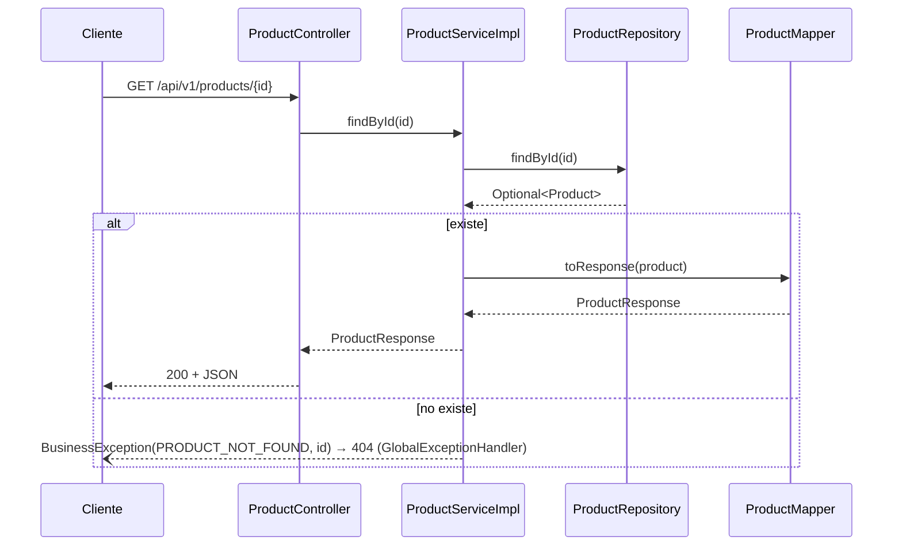

# Design

## Context

El bootstrap dejó listo todo lo que este change necesita y no hay que tocar: tabla `products` (V2) con sus 6 filas semilla (V4), `ErrorCode.PRODUCT_NOT_FOUND`, `BusinessException`, el `GlobalExceptionHandler` (ya traduce el id no numérico a 400, la ruta inexistente a 404 y el método no soportado a 405), los contratos `product-response` y `product-list`, `ContractAssertions`, `IntegrationTest` y un `SecurityConfig` provisional con todo público. El paquete `com.shoplab.api.product` solo tiene su `package-info.java`.

Ver `proposal.md` para la motivación y `specs/product-catalog/spec.md` para el comportamiento.

## Goals / Non-Goals

**Goals:**
- Que el paquete `product` sirva de **plantilla** para las features siguientes: mismos nombres de clase, mismo reparto de responsabilidades y mismo tipo de tests por capa.
- Activar en `ArchitectureTest` las reglas que solo se pueden comprobar con un `ServiceImpl` real.

**Non-Goals:**
- Descuento de stock (`decreaseStock`, `UPDATE ... WHERE stock >= :quantity`): llega con `orders`, que es quien lo usa.
- Crear, editar o borrar productos, paginación, filtros o búsqueda (§1, §7.3).
- Cambiar `SecurityConfig`: la ruta pública definitiva (`/api/v1/products/**` en `permitAll`) la fija `auth-jwt-filter`.

## Decisions

### D1. Las clases del paquete `product`

```
product/
├── Product.java               ← @Entity, solo lectura
├── ProductRepository.java     ← JpaRepository<Product, Long>
├── ProductService.java        ← interfaz: findAll(), findById(Long id)
├── ProductServiceImpl.java    ← @Service @Transactional(readOnly = true)
├── ProductMapper.java         ← @Component: Product → ProductResponse
├── ProductController.java     ← @RestController @RequestMapping("/api/v1/products")
└── dto/ProductResponse.java   ← record con los 7 campos del contrato
```



- **El service devuelve `ProductResponse` o lanza la excepción**; nunca `Optional` ni `null` (bootstrap D1). El `orElseThrow` vive en el `ServiceImpl`.
- **El controller devuelve `ResponseEntity.ok(...)`** aunque solo haya 200: así el código es igual al de los controllers que devuelven 201 y el junior ve siempre el mismo patrón. *Alternativa descartada:* devolver el DTO directamente, que es más corto pero rompe la plantilla.
- **El controller recibe `@PathVariable Long id`**. Si el id no es un entero (`abc`, `1.5`, o un número que no cabe en `Long`), Spring lanza `MethodArgumentTypeMismatchException` y el handler existente responde 400. No se añade validación propia.
- **`0` y `-1` no se validan aparte**: `findById` no los encuentra y responden 404, como pide §7.6. *Alternativa descartada:* `@Positive` en el path, que daría 400 y contradice el documento.

### D2. Entidad `Product` de solo lectura

- Campos: `id`, `sku`, `name`, `description`, `price` (`BigDecimal`, `@Column(precision = 12, scale = 2)`), `stock` (`Integer`), `imageKey` (`@Column(name = "image_key")`) y `createdAt` (`Instant`). Se mapea `createdAt` aunque no se exponga, para que la entidad represente la tabla completa.
- Constructor vacío `protected` (lo exige JPA) y **solo getters**: en este change nadie modifica un producto. Sin `equals`, `hashCode` ni `toString` (§11 regla 10).
- Para crear productos en los tests unitarios hace falta un constructor con datos. Se añade un constructor público con todos los campos menos `id`, y los tests fijan el id con `ReflectionTestUtils.setField`. *Alternativa descartada:* `setId` público, que permitiría cambiar el id desde el código de producción.

### D3. Orden del listado

`ProductRepository` declara `List<Product> findAllByOrderByIdAsc()`. *Alternativa descartada:* `findAll(Sort.by("id"))` en el service, que esconde el orden en un objeto `Sort` y es menos evidente para un junior. El nombre del método documenta la regla de §7.3.

### D4. Precio en el JSON

`ProductResponse.price` es `BigDecimal`. PostgreSQL devuelve `numeric(12,2)` con escala 2 y Jackson escribe el `BigDecimal` respetando esa escala, así que `25.00` sale como el número `25.00`. No hace falta configurar Jackson. Hay un test que lo verifica (`$.price` de `GET /products/4` es `25.00` en el texto del JSON), porque es justo lo que rompería un `double`.

### D5. Tests por capa (la plantilla de pruebas)

| Test | Tipo | Qué verifica |
|---|---|---|
| `ProductMapperTest` | Unitario | Los 7 campos se copian tal cual; `createdAt` no aparece en el DTO |
| `ProductServiceImplTest` | Unitario (Mockito) | Listado en el orden del repository; detalle encontrado; `PRODUCT_NOT_FOUND` con el id en el mensaje. Usa un `ProductRepository` mock y un `ProductMapper` **real** (bootstrap D1.4) |
| `ProductControllerTest` | `@WebMvcTest(ProductController.class)` + `@MockitoBean ProductService` | Status, JSON, contrato, 404 con el formato de error, 400 por id no numérico, 405 para `DELETE`/`POST` |
| `ProductCatalogIT` | `IntegrationTest` (Testcontainers) | Flujo completo contra los datos semilla: 6 productos en orden, detalle del producto 1, stock 0 y 1, 404 de `/products/99`, contrato de cada respuesta |

`ProductControllerTest` importa `SecurityConfig` y `GlobalExceptionHandler`, igual que `GlobalExceptionHandlerTest`, para que las respuestas de error sean las reales.

### D6. Reglas nuevas en `ArchitectureTest`

| Regla | Por qué ahora |
|---|---|
| Las clases que terminan en `ServiceImpl` están anotadas con `@Transactional` (de Spring) | Regla 2 de §11.2; antes no había ningún `ServiceImpl` que comprobar |
| Cada `ServiceImpl` implementa una interfaz que termina en `Service` | Los controllers dependen de la interfaz (§5, D de SOLID) |
| Los métodos públicos de los `ServiceImpl` no devuelven `Optional` ni clases `@Entity` | Bootstrap D1: el service devuelve DTOs o lanza `BusinessException` |

Las reglas nuevas usan `allowEmptyShould(false)` porque ya existe `ProductServiceImpl`: si un cambio de nombre las dejara sin clases que comprobar, deben fallar en vez de pasar en silencio.

## Risks / Trade-offs

- [El controller de prueba de `GlobalExceptionHandlerTest` ya cubre `/test-errors/items/{id}`; el 400 por id no numérico se prueba otra vez en `ProductControllerTest`] → Se acepta la repetición: la spec de `product-catalog` debe tener su propio test, y documenta el caso para quien copie la plantilla.
- [Los tests de integración comparten la base de datos y aún no existe `/test/reset`] → `ProductCatalogIT` solo lee; no modifica productos.
- [Cuando `auth-jwt-filter` reemplace el `SecurityConfig`, el catálogo podría quedar protegido por error] → La spec incluye el requisito *Acceso público*, y `ProductCatalogIT` lo comprueba sin cabecera `Authorization`; ese test fallará si la ruta deja de ser pública.
